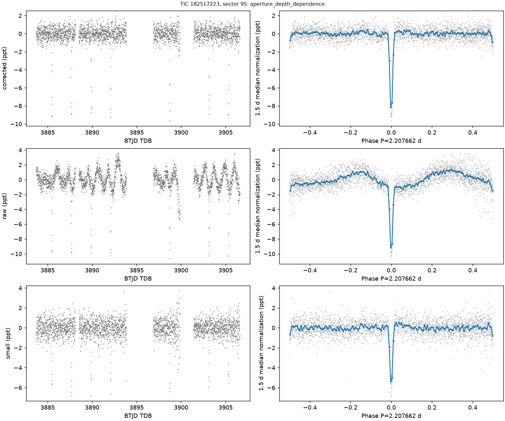

# TIC 182517223: independently recovered known spectroscopic binary

Assessment16October2026UTC: **not a new planet or previously unknown star**. The approximately2.20768-day eclipse sequence recurs in five examined TESS sectors, including a Sector95 empirical-error search. Its raw primary and half-phase secondary are approximately7636±103ppm and938±109ppm. The generic secondary-warning threshold originally missed the comparatively shallow secondary; absence of that warning was not absence of an eclipse.

Exact Gaia DR3 source4684552891681165440has a published **SB1** orbit: P2.2076461525±0.000023days, K1=63.98±0.55km/s, eccentricity≈0.0136. The photometric period differs by only approximately3.25seconds. Under that published orbital interpretation the mass function is0.05990±0.00155solar masses. With the saved TIC primary-mass assumption1.21solar masses and sin(i)=1, the secondary minimum mass is approximately0.576solar masses. This is a conditional mass-function inference, not an independent RV fit or a model-independent mass measurement.

[The quantitative recognition/derivation](../../../results/multisector_recognition/tic182517223_sb1_assessment.json) retains the exact Gaia row, source-response hashes, equation, primary-mass sensitivity and limitations. Per-sector event tests and `joint.json` preserve the photometry; repeated sectors and detrenders are correlated checks, not additional stars. The target is retained as a useful binary false-positive control.

