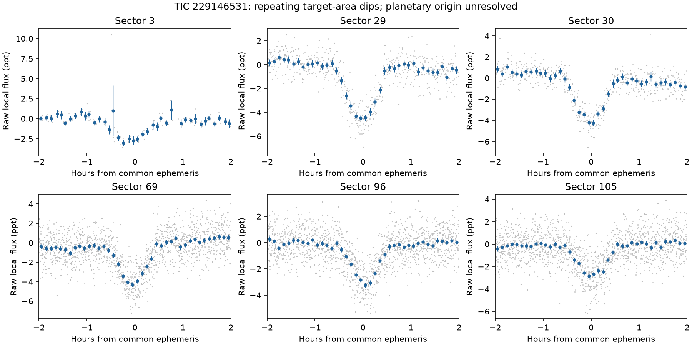
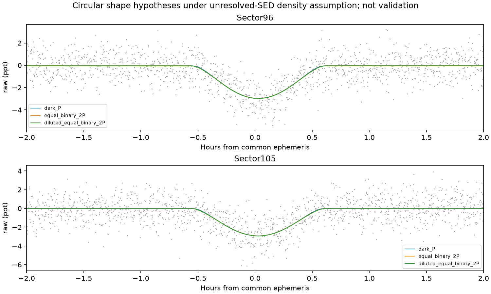

# TIC 229146531: real recurrent dips, unresolved companion class

Assessment on **16 October 2026 UTC**: the light loss repeats in six TESS sectors and is localized to the target area. **A new planet, a new star, and the novelty of this short-period signal are not established.** This is the highest-priority unresolved transit/eclipsing signal from the six-sector campaign.

The visible source is already catalogued: Gaia DR3 **4913366449740781696**, 2MASS J01482854−5208201, TYC 8047-00270-1; approximate J2000 position RA 27.118916°, Dec −52.138940°. It has a **published Gaia astrometric binary orbit, 321.38943 ± 0.82288 days**, and a solar-like/ROT variability classification. That long orbit does not explain a 0.935-day eclipse sequence, and the checked rotation tables do not publish a rotation period for this target.

## Measured recurrence

One common discovery-sector refinement gives **P = 0.9350235801 days**, epoch **BTJD 3910.20246798 TDB**. The screening box duration is 0.0343 days (49.4 minutes); a physical or trapezoid contact duration depends on the grazing shape. Local window averages are not central transit depths.

| Sector | Raw local depth (ppm) | Conditional local S/N |
|---|---:|---:|
| 3 | 2112 ± 161 | 13.13 |
| 29 | 3534 ± 117 | 30.31 |
| 30 | 3055 ± 106 | 28.87 |
| 69 | 3041 ± 101 | 30.19 |
| 96 | 2223 ± 64 | 34.61 |
| 105 | 2165 ± 133 | 16.34 |

These tests use the unchanged common discovery ephemeris. The historical sectors were already inspected with an inferior coarse ephemeris, so this is conditional recurrence evidence, not a pristine held-out detection experiment. Depths change with sector, aperture, baseline and sampling; a single shared dilution is not measured. Sector 96/105 producer error arrays were unusable, so their analysis explicitly uses the versioned adjacent-difference uncertainty assumption and residual/event-scatter floors. Original FITS errors and quality flags are preserved.



The original single-sector period 0.93491139 days drifts approximately 53 minutes by Sector 105. Its apparent non-recoveries in older sectors were **not valid disproofs**. A separate fit to 41 selected discovery-sector event timings gives P = 0.93501906 days; the event-resampling 16–84% interval is 0.93501689–0.93502100 days. These approximate uncertainty estimates omit timing-template and correlated systematic errors and are not a precision six-sector orbital solution. Propagated historical phase windows are retained in `event_timing_and_phase_windows.json`; their median-flattened scores use a different baseline from the raw local tests above.

## What survives falsification

Eight native Sector 96 pixel variants, including sky subtraction, first/second-degree local baselines and the intersection with QLP quality flags, give source-like differences with maximum pixel S/N 12.7–17.6 and offsets 0.086–0.115 native pixels from the target. This supports a real target-area deficit, not a precise component assignment within an unresolved binary.

An empirical reference-image fit that includes image gradients and background planes retains approximately **2992 ± 158 ppm** (2.5-pixel region, sky-subtracted, quadratic baseline) or **2966 ± 131 ppm** (3.5-pixel region). The same diagnostic largely removes apparent deficits in TIC 183373155 and TIC 71274048. These are conditional pixel fits, not calibrated detection probabilities. WCS, PRF mismatch, pixel covariance and unresolved blends remain limitations.

## Why this is not yet a credible new planet

Exposure-integrated circular `batman` shape fits compare a dark companion every P with an equal-luminosity grazing stellar binary orbiting every 2P. Both use local raw Sector 96/105 data, fixed limb darkening and an illustrative density constraint from the unresolved TIC stellar SED.

| Hypothesis | Period (days) | Radius ratio | Impact parameter | Raw photometric χ² (4183 points) |
|---|---:|---:|---:|---:|
| Dark companion, TIC density assumption | 0.935024 | 0.091 | 0.995 | 3848.32 |
| Equal-star grazing binary | 1.870047 | 1.000 | 1.923 | 3847.63 |
| Dark companion, alternative distance-scaled density | 0.935024 | 0.486 | 1.428 | 3847.53 |

The difference is insufficient to distinguish these physical classes. The third row illustrates the radius/density/grazing degeneracy; it is not a new stellar-radius measurement. Fixed-radius profiles likewise do not produce a companion-radius posterior. The known unresolved binary compromises single-star SED priors. Mass, component luminosities, dilution, eccentricity and full binary effects are unmeasured; these χ² values are conditional shape comparisons, not model odds or false-positive probabilities.



Alternating depths at a common ephemeris are inconsistent between sectors: raw signed differences are +3.96 diagonal σ in Sector 29 and −4.09 in Sector 105. Across six sectors the normalized mean difference is only 1.05 diagonal σ, or 0.39 after a descriptive heterogeneity inflation. A wider 0.05-day window reduces that to −0.40/−0.20. Neither averaging absolute significances nor selecting the strongest sector justifies a doubled-period claim. Equal-depth stellar eclipses remain allowed. Half-phase secondaries are weak and do not securely exclude stellar configurations. Strong orbital variability also requires modeling rather than automatic rejection.

## Recognition scope and useful next work

Checked on 16 October: fresh NASA confirmed/TOI tables, ExoFOP CTOIs and target record/notes/files, RAVEN release tables, the TESS eclipsing-binary catalogue, the complete Kostov 2025 new/known tables, Gaia NSS/variability, VSX, SIMBAD aliases, WDS, Avallone 2022 and bounded literature searches. The specific approximately 0.935-day sequence was not identified in these checks. **Finite catalogue nonmatches and unsuccessful alias searches do not prove priority.** The star and its 321-day companion were already known. Exact responses and query manifests are under `results/multisector_recognition/b02_096_105/` and `data/multisector/catalogs/`.

The best discriminants are independent reduced light curves with a joint variability/eclipse fit, resolved or high-resolution multicolour photometry, spectra/RVs testing both 0.935 and 1.870 days while accounting for the known outer orbit, and stronger archival-literature/alias review. Do not submit a planet or new-star discovery based on this dossier alone. No external submission has been made.

## Reproduction and data

Sources, retrieval URLs, SHA-256 hashes, columns, cadences and per-event tests are in `batch02_followup.json`, `batch02_joint_retest.json`, `six_sector_raw_folds.json`, `physical_*_data.json` and `sector96_transit_difference/raw_manifest.json`. Native FFI identifiers are retained. Raw QLP light curves and the native pixel cube/ZIP remain outside Git in `/workspace/tess-research-data/multisector/`; cloud durability is unverified. The campaign checkpoint inventories the originals and public retrieval URLs. Arrays and key plots for this target are tracked.

With the repository's prepared environment and one BLAS thread, the existing inputs can reproduce the dedicated checks:

```sh
python scripts/tic229146531_physical.py --models --timing
python scripts/tic229146531_parity.py
python scripts/tic229146531_overview.py
python scripts/multisector_pixel_redistribution.py
```

These commands intentionally regenerate derived files; preserve a previous checkpoint before changing methods. Scientific source hashes are recorded. No paid API calls were needed.
