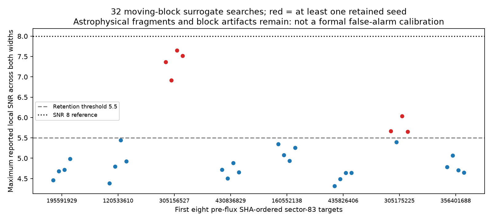

# Moving-block surrogate diagnostic

This supplements the [actual-signal recovery controls](README.md) without
modifying their frozen code or checkpoint.

The first **eight pre-flux SHA-ordered sector-83 targets** supply four seeded
surrogates each: **32 surrogate searches**, each processed by the same frozen
two-width expanded search. Targets are selected from the saved selection table
without inspecting their flux or removing known/possible variable stars.

Each quality-filtered, gap-defined raw segment is normalized by a one-day
running median. Paired normalized fluxes and errors are sampled in random
circular blocks with nominal length **0.4 days**, within that segment, then
multiplied by its original smooth trend. The original observation times and
gaps remain. The final method applies its ordinary 0.75- and 1.5-day detrending
and the same period/duration searches. Every source-index mapping and generated
flux/error array is retained outside Git with an exact hash.

**Seven of 32 searches generate at least one retained seed.** These all come
from two of the eight original stars, demonstrating the importance of
star-dependent structure and deeper vetting after a 5.5-SNR retention cut.
The maximum reported local SNR, taking both widths together, has median **4.90**,
90th percentile **6.82**, and maximum **7.65**. None exceeds 8 in this small set.
Peak counts can include aliases and correlated detrending variants; those
counts are not independent false events.

| Original target | Surrogate searches with retained seed / 4 |
|---|---:|
| TIC 195591929 | 0 |
| TIC 120533610 | 0 |
| TIC 305156527 | 4 |
| TIC 430836829 | 0 |
| TIC 160552138 | 0 |
| TIC 435826406 | 0 |
| TIC 305175225 | 3 |
| TIC 356401688 | 0 |

The unchanged TIC 305156527 light curve already has a strong 0.506-day peak
with local SNR 17.7. Its block surrogates retain astrophysical/structured
fragments and generate maxima of 6.9–7.7. TIC 305175225's unchanged scan has a
maximum local SNR of 6.43. We preserve these outcomes rather than selecting
quieter stars after observing the result.



**This is an empirical noise-behavior diagnostic, not a valid global null or
false-alarm calibration for the survey.** Only eight independent observed stars
are used; repeated surrogates and detrending variants are correlated. Signals
and red noise shorter than a block can remain, block joins introduce artifacts,
longer correlations change, and a fixed trend does not ensure stationary
residuals. Surrogate maxima refer to the reported refined peaks, not every
possible transit model. Neither 7/32 nor 0/32 is a planetary false-positive
probability. No small p-value or survey-wide false-alarm probability follows.

The result supports keeping 5.5 as an inexpensive **follow-up** threshold only.
Independent recurrence, source localization, alternative noise models and
astrophysical vetting remain necessary.

```bash
cd /workspace/Space_ChatGPT
OMP_NUM_THREADS=1 OPENBLAS_NUM_THREADS=1 \
  /workspace/openrouter-check-venv/bin/python src/multisector_nulls.py
OMP_NUM_THREADS=1 OPENBLAS_NUM_THREADS=1 \
  /workspace/openrouter-check-venv/bin/python candidates/multisector_controls/summarize_nulls.py
```

Results: [per-search table](../../results/multisector_controls/nulls/iterations.csv),
[summary](../../results/multisector_controls/nulls/summary.json),
[frozen design](../../results/multisector_controls/nulls/config.json), and
[raw observation manifest](../../results/multisector_controls/nulls/observations.json).
Generated arrays live under
`/workspace/tess-research-data/multisector/controls/nulls/` and are reproducible
from the saved raw observation URLs, hashes and per-search seeds. No paid calls
were used.
