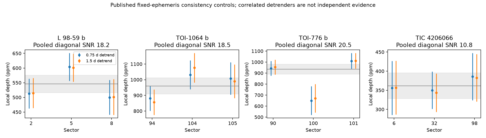
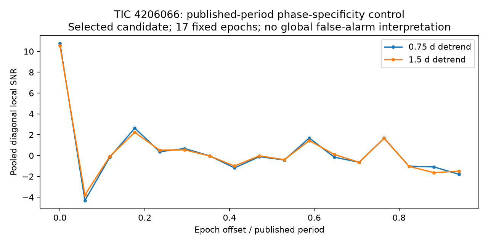
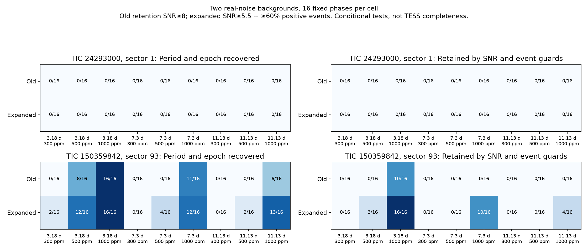

# Recovery and sensitivity controls for expanded TESS screening

Checkpoint: 15 October 2026, America/Halifax (machine-readable timestamps use UTC).
These are controls using known targets and injected signals, **not new candidates**.

The expanded method preserves more shallow, repeatable signals for follow-up,
but still misses weak signals in noisy individual sectors. These experiments do
not measure representative TESS completeness or a survey false-alarm rate.

## Real planetary signals

The controls use existing, hash-verified raw observations. No synthetic signal is
added in this part. The three confirmed planets were selected from the retained
NASA Exoplanet Archive snapshot for shallow catalogued transits and multiple
cached sectors. Other catalogued planets in each host are masked; the tested
planet is not masked. Both methods search periods without being supplied the
tested planet's period or epoch. Published ephemerides are used afterward to
assess recovery and for the separate fixed-ephemeris consistency measurements.

| Control | Catalogued depth | Sectors | Old period + epoch recovered | Expanded recovered | Old retained | Expanded retained |
|---|---:|---|---:|---:|---:|---:|
| L 98-59 b | 589 ppm | 2, 5, 8 | 3/3 | 3/3 | 3/3 | 3/3 |
| TOI-1064 b | 1,067 ppm | 94, 104, 105 | 3/3 | 3/3 | 3/3 | 3/3 |
| TOI-776 b | 909 ppm | 90, 100, 101 | 3/3 | 3/3 | 2/3 | 2/3 |
| TIC 4206066 reported candidate | Not assumed | 6, 32, 98 | 3/3 | 3/3 | 1/3 | 2/3 |

TOI-776 b sector 100 has only one locally measurable event at the recovered
ephemeris, so rejection by the repeated-event guards is appropriate. Its other
sectors supply recurrence evidence. TIC 4206066 sector 6 remains below the new
5.5 retention threshold (maximum matched local SNR 4.98). Sectors 32 **and 98**
now pass the exact new retention guards; the old method retained sector 32.

TIC 4206066's published fixed ephemeris gives 20 locally sampled events across
the three sectors, positive depths in all sectors, and a pooled depth of
**362 ± 34 ppm** with the 0.75-day detrending width. The resulting diagonal local
SNR is 10.76. With the correlated 1.5-day detrending variant, the corresponding
values are 358 ± 34 ppm and 10.53. These estimates **do not independently validate
a planet**. They condition on a known candidate, a published period and epoch,
and diagonal noise errors; ephemeris uncertainty is not propagated.

Sixteen equally spaced displaced epochs at the **same published period**, plus
the published epoch, check phase specificity. The largest displaced-epoch pooled
SNR is 2.63 (0.75-day detrending) or 2.23 (1.5-day). This deliberately limited,
selected-target test is **not a blind period search or global false-alarm
probability**. The two detrending variants are correlated evidence.





## Real-noise injections

Two backgrounds were fixed before injection outcomes: TIC 150359842 sector 93
(2-minute SPOC, a retained field target) and TIC 24293000 sector 1 (30-minute
QLP, the first retained artifact encountered by the initial filesystem probe).
There was no selection for quietness or successful recovery. The latter star is
faint (TESS magnitude 13.196), noisy and heavily segmented; it is intentionally
retained as a negative sensitivity result.

For each background, the experiment injects 300, 500 and 1,000 ppm boxes at
periods 3.18, 7.3 and 11.13 days, with a fixed 0.08-day duration and 16 seeded,
stratified phases per cell. Eleven midpoints integrate each box over the nominal
exposure time. The multiplicative signal is applied to the **observed flux
before detrending**, retaining the original noise, gaps, quality flags and
systematic effects. Formal flux errors are unchanged. There are **288 distinct
injections, each searched by both methods: 576 actual-data searches total**.
The two methods do not provide 576 independent injections.

Recovery requires period error below 0.3% **and** agreement of predicted transit
centres across the observed sector within 0.75 injected durations. A matching
period alone does not count. Retention additionally requires sampled positive
events, the dominance and duty-cycle guards, and the method's local SNR cut.
Some long-period phases do not supply two measurable events; those negative
outcomes remain in the tables, with the sampled-event count recorded.

| Injection into TIC 150359842 sector 93 | Old retained / 16 | Expanded retained / 16 | Expanded at the same SNR ≥ 8 / 16 |
|---|---:|---:|---:|
| 3.18 days, 300 ppm | 0 | 0 | 0 |
| 3.18 days, 500 ppm | 0 | 3 | 0 |
| 3.18 days, 1,000 ppm | 10 | 16 | 11 |
| 7.3 days, 300 or 500 ppm | 0 each | 0 each | 0 each |
| 7.3 days, 1,000 ppm | 0 | 10 | 1 |
| 11.13 days, 300 or 500 ppm | 0 each | 0 each | 0 each |
| 11.13 days, 1,000 ppm | 0 | 4 | 0 |

Total retention in this one SPOC background is **10/144 old versus 33/144
expanded**. At the **same SNR ≥ 8**, the expanded method retains 12/144.
Much of the practical increase therefore comes from a lower follow-up threshold,
which increases the need for subsequent validation. It does not increase the
statistical significance of a weak signal. The larger seed list also improves
finding the injected period and epoch before the retention cuts.

The faint sector-1 background recovers **0/144** injections under either method.
Its typical fixed-ephemeris SNR is only about 0–1 even for 1,000 ppm signals.
An unchanged scan of each background is preserved for each method; none supplies
a retained ≥5.5-SNR signal. Two examples cannot calibrate a false-positive rate.



## Implications and limits

- Retain multiple candidate periods and refine them; a top-two coarse ranking
  can discard a real subdominant signal.
- Compare a finer duration grid and more than one sensible detrending width.
  The alternatives use the same observations and are not independent evidence.
- Transfer plausible ephemerides to other sectors rather than requiring every
  sector to pass SNR 8 on its own.
- A transfer-only workflow still misses signals that never create a retained
  seed. A genuine pooled-sector period search is needed for those cases,
  especially adjacent sectors and long periods.
- Despite `max_period=20` in the expanded configuration, the frozen underlying
  period-grid function caps each search at half the usable baseline. A single
  27-day sector therefore does not search all periods to 20 days. The actual
  searched maximum is recorded in every scan.
- Neither background supplies retained 300 ppm recoveries. The current small
  experiment cannot support strong negative claims about such shallow planets.
- Box shapes, one duration, two backgrounds and 16 phases per cell do not cover
  the distribution of real stellar variability, transit shapes or contaminants.
  No global trials correction, red-noise calibration, centroid check, transit
  fit, literature validation or false-positive probability is provided here.

## Reproduction and evidence

All original flux artifacts are retained at their existing cache locations.
`actual_controls_*.json` and `injections_*_observations.json` record source paths,
retrieval URLs, SHA-256 hashes, pipeline versions, flux columns, FITS checksums
and counts. Previously committed input manifests are verified before reading.
The method code hashes and fixed experiment design are saved with the outputs.
No paid calls were used and no old scientific outputs were modified.

```bash
cd /workspace/Space_ChatGPT
export OMP_NUM_THREADS=1 OPENBLAS_NUM_THREADS=1
export MPLCONFIGDIR=/workspace/tess-research-data/matplotlib
PY=/workspace/openrouter-check-venv/bin/python
$PY src/multisector_controls.py controls --method old
$PY src/multisector_controls.py controls --method new
$PY src/multisector_controls.py injections --method old
$PY src/multisector_controls.py injections --method new
$PY candidates/multisector_controls/make_report.py
```

Injection JSONL files are append-only checkpoints; rerunning the same frozen
design skips completed case IDs. A changed source hash or design is rejected
rather than silently mixed into an existing experiment. Use new output names
for a changed scientific experiment. The helper script regenerates the exact
retention audit and plots from the saved original scans.

The raw experiment JSONL's `queued` field is the documented
`screening_pass + SNR` proxy. **Use the exact audit for final new retention
counts**, because it also applies `multisector_screen.seed_reasons`' ≥60%
positive-event rule. Old retention here reproduces the event guards and SNR 8
cut, not the old catalogue, stellar-size and novelty classification.

- [Exact grouped retention table](../../results/multisector_controls/exact_retention_summary.csv)
- [Exact per-case retention audit](../../results/multisector_controls/exact_retention_audit.json)
- [Actual old-method controls](../../results/multisector_controls/actual_controls_old.json)
- [Actual expanded-method controls](../../results/multisector_controls/actual_controls_new.json)
- [Displaced-epoch measurements](../../results/multisector_controls/tic4206066_phase_offsets.json)

The relative links above are provided for browsing from the repository root;
the machine-readable files live under `results/multisector_controls/`.
