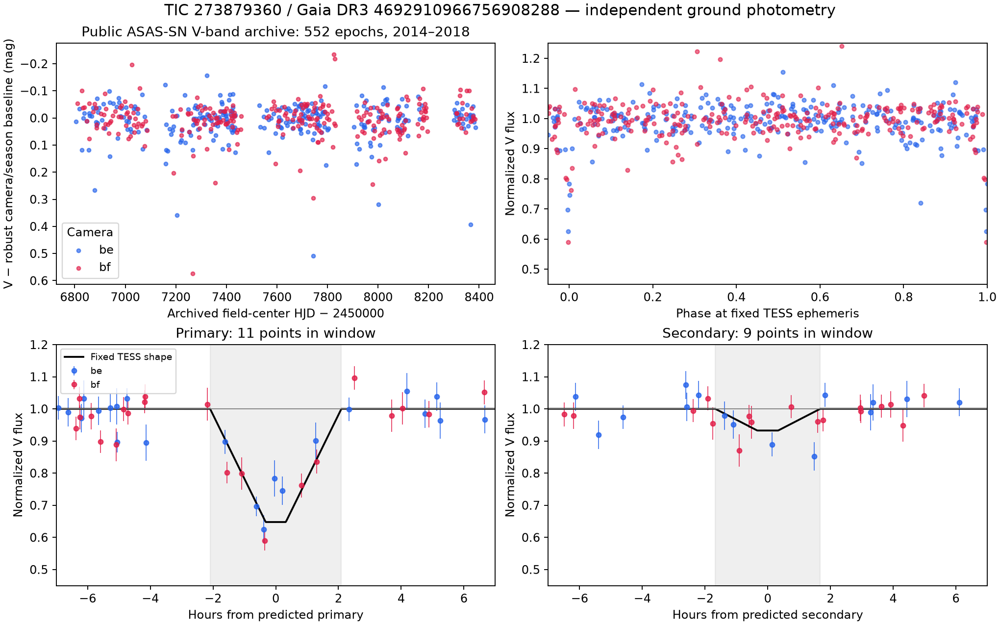

# Independent ground photometry at TIC 273879360

Checked 2026-10-14 UTC. **Public archived ASAS-SN V-band measurements independently show recurring deep primary eclipses at the fixed TESS ephemeris.** There are 11 primary-window measurements across nine separate events in 2014–2018; eight events precede TESS observations. This strengthens the validation of the eclipsing source near TIC 273879360. It provides no component masses or first-discovery claim.

The current prior-recognition audit identifies **published Kostov 2025 neural-network eclipse-like-feature flags for this source in Table 2**. Those prior flags preclude calling it entirely unrecognized or claiming first recognition here. The additional result is independent ground-data validation and characterization. The ASAS-SN archival identifier itself establishes earlier public photometry; it does not supply a binary classification.

## Source and retrieval

The [public archived source AP36443078](https://asas-sn.osu.edu/photometry/60ccbd79-2dcc-58ba-8a9b-41b1ac9c8b08) has coordinates RA 32.25233°, Dec −71.32316°, **0.158 arcsec from TIC 273879360 / Gaia DR3 4692910966756908288**. Its aperture is distinct from the brighter foreground TIC 273879358, approximately 65.6 arcsec away. Public Sky Patrol catalog metadata also matches the exact TIC and Gaia identifiers, with ASAS-SN ID 463857005495.

The archived CSV contains **552 measurements from 2014-05-28 through 2018-09-23**, all from V-band cameras `be` and `bf`. Every exported row was verified against the complete measurement array embedded in the HTML. The HTML summary field says “Epochs 540”; the actual CSV, embedded array and JSON count agree on 552. This discrepancy is preserved. The JSON endpoint is paginated; its retained first page is provenance, while the CSV and embedded array contain all measurements.

New Sky Patrol lightcurve access is temporarily unavailable. Its anonymous catalog API works, but the [public status endpoint](http://asassn-lb01.ifa.hawaii.edu:9006/get_api_status) explicitly reports “Lightcurve service will be unavailable for the next couple days while we run maintanence. 13 October 2026”. The current public frontend's direct lightcurve endpoint returns an error body, and the released Python client's three documented photometry workers fail. The older public archive above remains available. No login, paid API, observing request or external submission was used.

Raw responses and UTC retrieval time, exact request URL/body, HTTP status, byte count and SHA256 manifests are retained in [the ground-data cache](../../../../data/stellar_systems/deep_context/ground_photometry/). Failure bodies remain alongside successful catalog and archival responses. The downloaded public client wheel was verified against its published PyPI SHA256; its code was inspected, not executed.

The 5,457,084-byte public website JavaScript response is retained intact outside Git under `TESS_DATA_DIR/stellar_systems/deep_context/ground_photometry/`, defaulting to `/workspace/tess-research-data/stellar_systems/deep_context/ground_photometry/`. Its [tracked manifest](../../../../data/stellar_systems/deep_context/ground_photometry/asassn_public_http_script0.js.manifest.json) preserves the original URL and SHA256 `e74988144b34f5c8dde993e74324409ef4d7ffe27e5381f2d07f4f2d7c357641`. It records public API-route provenance and is optional for reproducing the scientific analysis. The helper verifies it when present; `--restore-auxiliary` retrieves a missing copy and rejects changed bytes while retaining the mismatched response. No independent persistence of the outside-Git cache is assumed.

[Fresh missing-cache restoration](../../../../data/stellar_systems/deep_context/ground_photometry/asassn_auxiliary_restore_verification.json) was tested in an isolated external cache: the original public URL returned HTTP200 and exactly the preserved SHA256. The retained scientific cache was unchanged.

## Fixed-ephemeris validation

The period **7.586891287 d**, primary epoch **BTJD 1327.899918 (TDB)**, secondary phase **0.69179**, durations and ingress fractions were fixed from the prior TESS solution before this ground-data check. There was no ground-selected period, phase, width or timing optimization. All 552 finite detections were retained; the archival export has no per-epoch quality flags. Camera/observing-season medians were estimated outside both eclipse neighborhoods, and fits included separate camera/season offsets. Weights use the larger of the quoted flux uncertainty and the measured robust out-of-eclipse scatter.

| Check | Result |
|---|---|
| Primary sampling | 11 measurements, nine distinct cycles/nights |
| Primary dimming | Every measurement and every event is fainter than its robust baseline |
| Primary fixed-shape amplitude | 35.2% of normalized V flux |
| Conditional observing-night bootstrap 95% interval | 28.4–39.7%, 1,997 valid draws out of 2,000 |
| Camera-only / camera-season / local ±30 d baselines | 32.9% / 35.2% / 33.7% primary amplitude |
| Omit one primary event at a time | 33.2–36.7% primary amplitude |
| Primary fit with ±300-second timing offsets | 34.8–35.8%; all 11 primary points remain in window |
| Secondary sampling | Nine measurements in seven distinct cycles |
| Secondary fixed-shape amplitude | 6.7 ± 2.2% conditional error; weaker and camera-dependent |

Primary events occur on 2014-08-09; 2015-02-15, 08-31, 11-30; 2016-10-29, 12-21; 2017-08-13, 09-05; and 2018-09-04. Independent camera-specific local ±30/60/90 d baseline checks preserve dimming in all nine events; event-median dimming is approximately 0.28–0.29 mag. The amplitude is a descriptive, potentially diluted fit using TESS morphology in another band. Sparse sampling and differing camera response explain why it should not be interpreted as a precise intrinsic eclipse depth or radius ratio.

The secondary depression supports the TESS interpretation but is **not a secure independent secondary detection in both cameras**: separate fits give approximately 12.1% for `be` and 3.3% for `bf`. The observing-night bootstrap also has a broad upper tail, and secondary window counts change from nine to eight for a −300-second ephemeris offset. Neither photometric fit gives masses.



Numerical provenance is in [asassn_summary.json](asassn_summary.json), [all phased measurements](asassn_phased_measurements.csv), [per-event checks](asassn_event_checks.csv), and [night-block bootstrap draws](asassn_night_block_bootstrap.npz).

## Timing and spatial limits

The archived page explicitly states: **“The HJD values reported here are calculated for the field centers. If you need accurate timings (better than ~200 seconds), please recalculate the light curve…”** TESS times are BJD TDB, and the archived HJD time scale is unspecified here. The numerical fold deliberately does not pretend to convert these old timestamps into precise BJD TDB. A ±300-second sensitivity check leaves the primary recurrence intact, but these measurements cannot support a refined period, eclipse timing variation or precision orbital timing result.

The archive coordinates associate the photometric aperture with the background target. ASAS-SN aperture photometry still permits unresolved close blends and wing contamination. TESS native-pixel localization supplies the stronger spatial attribution; the ground recurrence supplies independent photons at the same ephemeris.

## Other public surveys

SkyMapper DR4 anonymously provides **50 resolved PSF epochs from 2014–2021**, 31 passing strict quality cuts. Object 498719638 exactly crossmatches the source Gaia identifier and lies 0.049 arcsec from its coordinates. Exposure-midpoint barycentric conversion and the fixed TESS ephemeris put **zero observations in either eclipse window**, including every flagged observation. The nearest measurements remain 64.7 minutes beyond the primary edge and 104.6 minutes beyond the secondary edge. These sparse observations neither confirm nor meaningfully reject eclipses. [The summary and retained timing/quality metadata](../../../../data/stellar_systems/deep_context/ground_photometry/skymapper_summary.json) and [phase coverage plot](../../../../data/stellar_systems/deep_context/ground_photometry/skymapper_phase_coverage.png) document this limitation.

Gaia explicitly reports no public epoch photometry or epoch RV for this source. A NOIRLab Source Catalog crossmatch has only one observation. Southern ATLAS forced photometry requires registration/token; it was not requested. The current public OGLE 2025 SMC ECL/ELL list has no entry within 120 arcsec; that catalog check does not establish absence of generic OGLE survey observations.

## Reproduce

From the existing checkout, using the validated Python environment:

```sh
cd /workspace/Space_ChatGPT
OMP_NUM_THREADS=1 OPENBLAS_NUM_THREADS=1 \
  MPLCONFIGDIR=/tmp/stellar-ground-matplotlib XDG_CACHE_HOME=/tmp/stellar-ground-cache \
  /workspace/openrouter-check-venv/bin/python scripts/stellar_ground_photometry.py --bootstrap-nights 2000
```

This verified command analyzes the byte-checked cache. Add `--retrieve` to fetch missing cached public responses; existing byte-matched responses are reused. Runtime versions are saved in [retrieval_context.json](retrieval_context.json). The existing environment gained `pyarrow==26.0.0` for anonymous catalog responses; repository requirements and lockfiles were not changed. SkyMapper's separate retained reproduction script is [skymapper_analyze.py](../../../../data/stellar_systems/deep_context/ground_photometry/skymapper_analyze.py).

Use `--restore-auxiliary` if the optional external JavaScript cache was lost. Set `TESS_DATA_DIR` to use a different external data root; the manifest retains both the original location and a relocatable cache-relative path.
