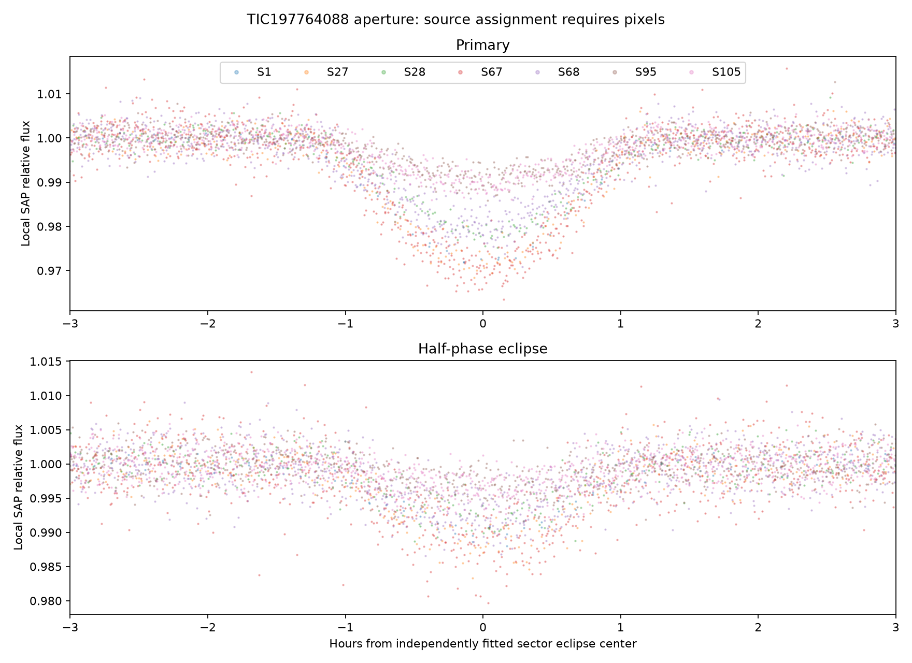
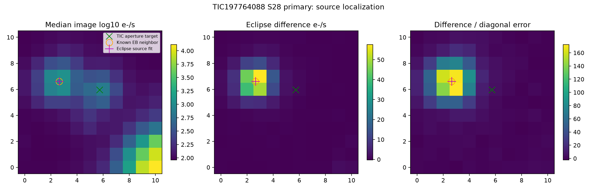
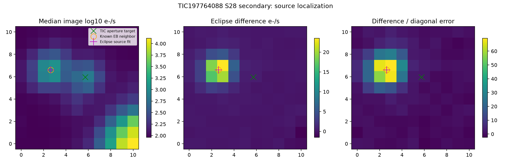

# TIC197764088 aperture: known neighboring eclipsing binary

**This lead is rejected as a previously unrecognized stellar companion.**
The repeating eclipses in the TIC197764088 QLP aperture originate near the known
neighbor **TIC197764089 / TYC8820-40-1 / Gaia DR3 6410698633034526976**, roughly
63.5 arcsec away. Both primary and secondary eclipses independently localize to
that neighbor. Its eclipsing-binary classification and period were already
published in Kostov et al. (2025), *The TESS Ten Thousand Catalog*,
[2025ApJS..279...50K](https://doi.org/10.3847/1538-4365/ade2d8), Table 3.

## Independent photometry

Seven public QLP sectors were retained and analyzed: **1, 27, 28, 67, 68, 95 and
105**. No SPOC short-cadence products were found in the saved MAST target query.
Each sector was independently searched near the initial period, followed by
native SAP event measurements with local quadratic baselines and empirical
event-scatter floors. Primary and half-phase events persist in every sector.
The raw aperture depth changes substantially with the observing sector,
consistent with changing dilution and aperture geometry.

| Sector | Mean primary box depth (ppm) | Mean half-phase box depth (ppm) |
| --- | ---: | ---: |
| 1 | 22,941 ± 362 | 8,211 ± 316 |
| 27 | 23,077 ± 551 | 9,854 ± 333 |
| 28 | 17,654 ± 302 | 6,257 ± 433 |
| 67 | 24,102 ± 378 | 9,610 ± 289 |
| 68 | 16,652 ± 233 | 6,150 ± 233 |
| 95 | 7,659 ± 157 | 2,694 ± 337 |
| 105 | 8,394 ± 172 | 3,056 ± 175 |

These are diluted mean in-window depths, not intrinsic central eclipse depths
or fully calibrated uncertainties. Four QLP aperture products were checked.
Modern QLP columns are named `DET_FLUX` rather than `KSPSAP_FLUX`; the exact
mapping is documented in the output. Formal errors are entirely NaN in sectors
95 and 105, so their native flux was retained and robust first-difference
scatter substituted before additional local baseline and event-scatter floors.

Fifty-two independently fitted primary-event times yield a conditional linear
ephemeris of **P = 2.682152997 ± 0.000001523 days**, epoch
**BTJD 1328.020552 ± 0.000960** (TDB), with 5.68-minute timing residual RMS.
The integer cycle assignment was seeded from independently fitted within-sector
periods. The published neighbor period is **2.682147 days**: the difference is
0.52 seconds (2.24 parts per million). Published period uncertainties and all
shape/detrending/timing systematics have not been compared, so the quoted
conditional error does not establish a significant period change.

QLP v01 sectors 102–104 were intentionally excluded because their published
timing corrections must be applied before use. Their geometric coverage is
retained in the coverage response; exclusion is not evidence of absent data.



## Pixel falsification

An original 11×11-pixel native sector-28 TESSCut FFI cube was retained. The
projected target was checked to lie on illuminated science silicon. Four local
pixel regression choices were evaluated separately at each eclipse phase:
quadratic baseline, background/pointing basis, broad box and core box. Gaussian
fits to the difference images and fixed-position source tests consistently favor
the neighboring star.

Two hundred whole-event plus synchronized residual-block bootstrap realizations
per phase give:

| Eclipse | Median distance from TIC197764088 | Median distance from known TIC197764089 | Realizations closer to neighbor |
| --- | ---: | ---: | ---: |
| Primary | 3.157 pixels | 0.026 pixels | 200/200 |
| Secondary | 3.182 pixels | 0.013 pixels | 200/200 |

These bootstrap fractions are a sensitivity check, not posterior source
probabilities. Gaussian/PRF, WCS and unpropagated proper-motion systematics are
not included. The roughly three-pixel separation is much larger than the
observed source-fit differences, and the same attribution appears at both
eclipse phases. It does not require treating a good-looking folded light curve
as host proof.





The actual Table-3 neighbor entry reports primary/secondary depths of **41/16
ppt**, period 2.682147 days and five sectors. Its Gaia RV amplitude is about
153 km/s and RUWE 2.37. The aperture target instead has Gaia RV variability
p≈0.655 and RUWE≈0.96. This context supports the spatial identification but
was not used as a substitute for the independent pixel test.

## Reproduction and preservation

```bash
OMP_NUM_THREADS=1 OPENBLAS_NUM_THREADS=1 python src/stellar_followup_197764088.py
python candidates/stellar_systems/tic197764088/pixel_test.py
```

- `observations.json` records all seven raw QLP download URLs, SHA-256 hashes,
  exact product names, sectors, metadata and FITS integrity checks.
- `pixel_observations.json` and `pixel_summary.json` preserve the native FFI cube
  retrieval URL, raw hash, processing version, release, detector/WCS information
  and source diagnostics. `ffi_product_identifiers.txt` lists original FFIs.
- `sector*_measurements.json`, `sector*_photometry.npz`, `sector_depths.csv` and
  `primary_event_timings.csv` preserve intermediate scientific measurements.
- Difference images, per-event difference/error maps and bootstrap centroids
  remain in compact NPZ artifacts alongside the source plots.
- Public Gaia/catalog context is retained under
  `data/stellar_systems/scout_novelty/`; the new and previously known TESS Ten
  Thousand tables contain 7,936 and 2,065 systems respectively. The large
  unvetted neural-network inventory is not treated as a classified EB catalog.

The raw QLP and pixel files remain in `/workspace/tess-research-data/` outside
ordinary Git tracking. No input observation was deleted or altered. No paid API
was used. This successful falsification is retained as evidence of why a source
must be localized before interpreting an apparently absent catalog match as a
new companion.
