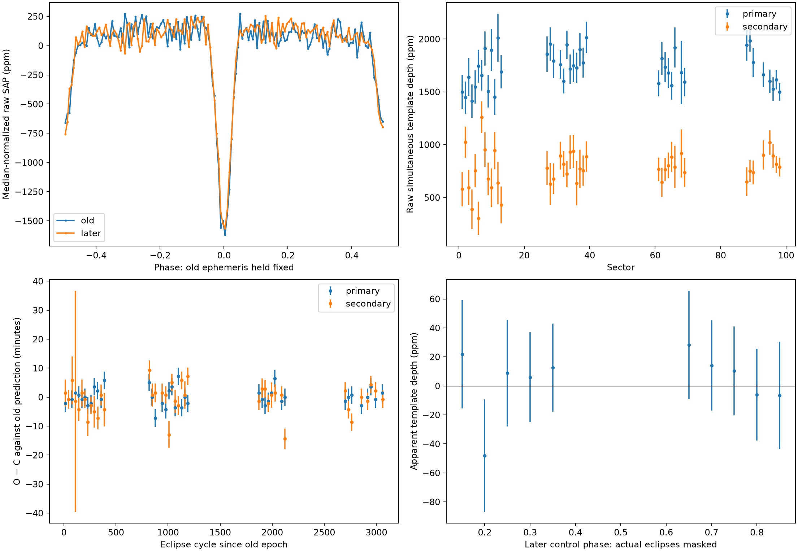
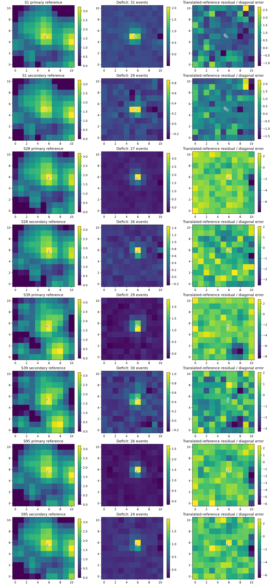

# TIC 260352037: deeper eclipse-blend validation

**The eclipses survive a 16-sector independent holdout, but the eclipsing
source remains unidentified.** There are now 41 QLP sectors spanning 7.45 years.
The refined conditional recurrence period is 0.880788521 ± 0.000000330 days.
Raw central template depths are approximately 1696 ± 27 and 784 ± 28 ppm.

See the [full falsification report](../../../reports/stellar_systems/tic260352037_validation.md)
for control failures/corrections, native-cadence shapes, timing stability,
alias checks, empirical pixel-template limitations, dilution constraints and
why a bound wide association is not established.

The second figure is a sensitivity experiment, **not calibrated PRF source
identification**. Its structured residuals and nuisance-dependent offsets
prevent attributing the binary to either neighbor. Conditional centroid
likelihood differences cannot establish a new component of a named star.

Key quantitative files: `photometry.json`, `event_depths.csv`,
`sector_timings.csv`, `morphology.json`, `timing_stability.json`, `pixels.json`,
`wide_pair_dynamics.json`, and per-sector pixel products/manifests. Code:
[`stellar_giant_validate.py`](../../../src/stellar_giant_validate.py).
