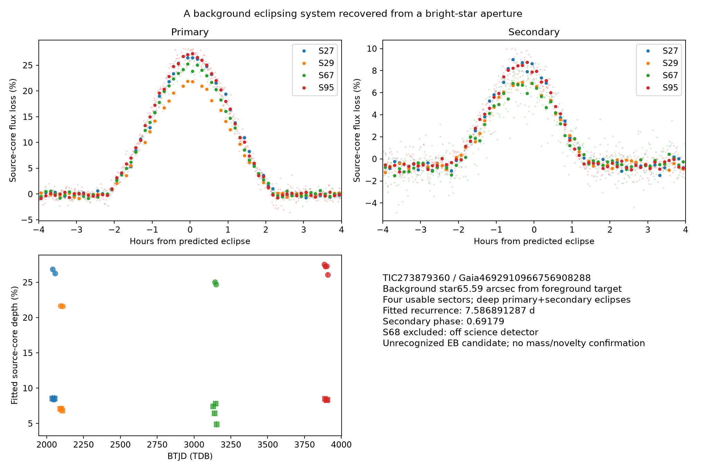

# TIC 273879360: a potentially unreported background eclipsing binary

Checked 2026-10-14 UTC. **Deep primary and secondary eclipses originate on or very near TIC 273879360, a background star whose light contaminated the brighter TIC 273879358. The observations strongly favor a luminous stellar companion. No prior binary classification was found in the documented catalog/literature checks, but first discovery and component masses are not confirmed.** The Gaia/TIC source itself was already catalogued; the potentially new result is its unresolved eclipsing multiplicity.

## Source identification

The earlier planet search found shallow eclipses in TIC 273879358's QLP aperture at approximately 7.587 days. Its strong aperture dependence required a source test. Independent native TESS difference images in sectors 27 and 29 put **both** eclipse types about 3.2 pixels from that aperture's target, on the fainter Gaia source below. Larger pixel cutouts were necessary: the initial sector-27 fit region excluded part of the source image and produced a biased centroid. The inadequate pilot and the corrected larger-cutout results are both retained.

| Quantity | Eclipsing background source |
|---|---|
| TIC | 273879360 |
| Gaia DR3 source | 4692910966756908288 |
| ICRS position | RA 32.252462825°, Dec −71.323170344° |
| Other identifier | 2MASS J02090051−7119235 |
| Separation from foreground TIC 273879358 | 65.59 arcseconds |
| TESS magnitude / Gaia G | 14.208 / 14.704 |
| Gaia parallax | 1.2310 ± 0.0167 mas |
| Current TIC radius / temperature | 0.9595 solar radii / 5,420 K |

The foreground star's parallax is approximately 2.688 mas, substantially larger than the source's. This establishes a background alignment rather than a bound pair with the foreground star. Current TIC distance estimates put the eclipsing source near 818 pc. Single-star catalog radius/temperature estimates can be biased by unresolved multiplicity and are not component measurements.

The foreground star also has published Gaia RV variability. That information belongs to the foreground object and must **not** be used as RV confirmation of this background binary. Their spectral velocities and eclipse signals are separate measurements on different sources.

## Independent later observations

The period, epoch and approximate widths selected in the original analysis were fixed before obtaining source-centered sectors 67 and 95. Both eclipse families recur near the predicted times and on the same background source in those later observations. The four usable pixel sectors span 2020–2025. There are 10 well-covered primary and 13 secondary events in the source-core depth measurements.

| Sector | Cadence | Primary source-core depth | Secondary source-core depth | Primary/secondary events |
|---|---:|---:|---:|---:|
| 27 | 10 min | 26.54 ± 0.30% | 8.49 ± 0.28% | 2 / 3 |
| 29 | 10 min | 21.65 ± 0.12% | 7.00 ± 0.23% | 2 / 3 |
| 67 | 200 s | 24.88 ± 0.16% | 6.91 ± 0.66% | 2 / 4 |
| 95 | 200 s | 27.24 ± 0.33% | 8.38 ± 0.18% | 4 / 3 |

These are exposure-integrated template depths in small apertures, including dilution from other stars. Different cameras/pixel boundaries change the aperture's light fractions; the depth changes must not be interpreted as changing companion size. Errors include per-event fit covariance and event dispersion, but not a complete correlated-noise, PSF or calibration model. The bright foreground core contains little eclipse signal, consistent with the off-target source.

In sectors 27 and 29, primary/secondary Gaussian difference centroids lie within 0.03–0.05 pixel of the background Gaia position, versus about 3.2 pixels from the foreground target. All 300 event/block bootstrap centroids per phase and sector favor the background source over the foreground target. Later sector-67/95 offsets are 0.06–0.12 pixel. Linear-baseline and fitting-region sensitivity checks support the same source neighborhood. These are empirical Gaussian fits rather than calibrated PRFs; an unresolved blend within the source image remains possible.

The TessCut API advertised sector 68 coverage, but the actual cutout placed the source at detector column 2130.37, outside illuminated science columns. Its overscan/collateral file is retained and **excluded**. This is an unusable product, not a missing eclipse or nondetection. All raw cubes have verified FITS HDU checksums, raw/science SHA256 identifiers, original FFI names and retrieval URLs.

## Eclipse timing and interpretation

A joint exposure-integrated trapezoid fit to the four source-core light curves gives:

| Parameter | Conditional fitted value |
|---|---:|
| Recurrence period | 7.586891287 ± 0.000000959 d |
| Primary epoch BTJD (TDB) | 1327.899918 ± 0.000246 |
| Secondary phase | 0.69179 ± 0.00004 |
| Primary / secondary total duration | 4.185 / 3.336 h |

The timing solution is conditional on the estimated templates and these same photons; the small diagonal errors omit some baseline, morphology and correlated systematics. The secondary's displacement from phase 0.5 favors an eccentric orbit, but a physical eccentricity/orbit has not been fitted. Trapezoids are descriptive eclipse shapes, not stellar-radius or mass solutions.

Repeated losses of roughly a quarter of the source-core light, followed by a distinct approximately 7–9% eclipse, are strong evidence for a luminous eclipsing system. Ordinary dark planetary transits cannot account for that optical light budget under the catalogued stellar interpretation. Spectroscopy is needed to measure the components and independently confirm their masses; resolved photometry can further constrain close blends.

## Recognition checks

Exact identifiers and 120-arcsecond field positions were compared against current VSX, live ASAS-SN plus its CDS mirror, Rowan 2022 ASAS-SN EBs, Petrosky 2021 WISE variables, Prša 2022 TESS EBs, Shi 2022 EA systems, Tang 2025 eccentric EBs, Battley 2022 **YOUNGSTER**, SB9, WDS, Tian 2020 wide binaries, and Gaia DR3 variability/actual NSS solution tables. The complete Traven 2020 GALAH SB2 table and both vetted Kostov 2025 TESS Ten Thousand tables were also checked. No binary/variable/source classification match was found for this source in that scope.

TIC 273879360 **does appear** in Kostov's Table 2 of approximately 900,000 unvetted/unvalidated targets. That row provides TIC, coordinates and magnitude; it has no period or EB classification. It is a prior target inventory entry, not a newly uncatalogued position. Tables 3/4 containing the 10,001 vetted EBs have no matching source or field entry.

Current ExoFOP has no uploaded companion/TOI/CTOI/files for this target. SIMBAD and selected arXiv alias searches found no source-associated report. These finite searches do not exhaust journal full text, supplementary tables, unpublished work or every alias. The appropriate result is **“strong potentially unreported eclipsing-binary candidate on or near TIC 273879360,”** pending external recognition review, not an established discovery of a new star.

The detailed source checks are [prior_audit_supplement.md](../../../reports/stellar_systems/prior_audit_supplement.md) and [complete-catalog matches](../../../results/stellar_systems/scout_fullcatalog_matches.json).

## Reproduce and preserve

From the repository with its installed Python dependencies:

```sh
export TESS_DATA_DIR=/workspace/tess-research-data
export MPLCONFIGDIR=/workspace/tess-research-data/matplotlib
export OMP_NUM_THREADS=1 OPENBLAS_NUM_THREADS=1
python src/stellar_pixels.py data/stellar_systems/tic273879358_large_config.json --sectors 27 29 --bootstrap 300
python src/stellar_pixels.py data/stellar_systems/tic273879360_config.json --sectors 67 68 95 --bootstrap 200
python src/stellar_background273.py
```

The second command intentionally exits nonzero after recording sector 68's scientific exclusion and successfully processing the valid sectors. Raw regenerated TessCut headers can differ byte-for-byte; preserve mismatches and compare science arrays before accepting a replacement. All raw files remain under `TESS_DATA_DIR/stellar_systems/pixels/`, outside Git; retrieval/checksum manifests and per-event scientific outputs are tracked. No cache persistence across fresh cloud tasks is assumed.

[Source measurements](source_summary.json), [per-event table](source_event_depths.csv), and the pixel dossiers retain the evidence. Recommended follow-up is resolved primary and secondary eclipse photometry centered on TIC 273879360, then spectroscopy near predicted quadratures to test a luminous companion. No observation requests or external submissions were sent.


