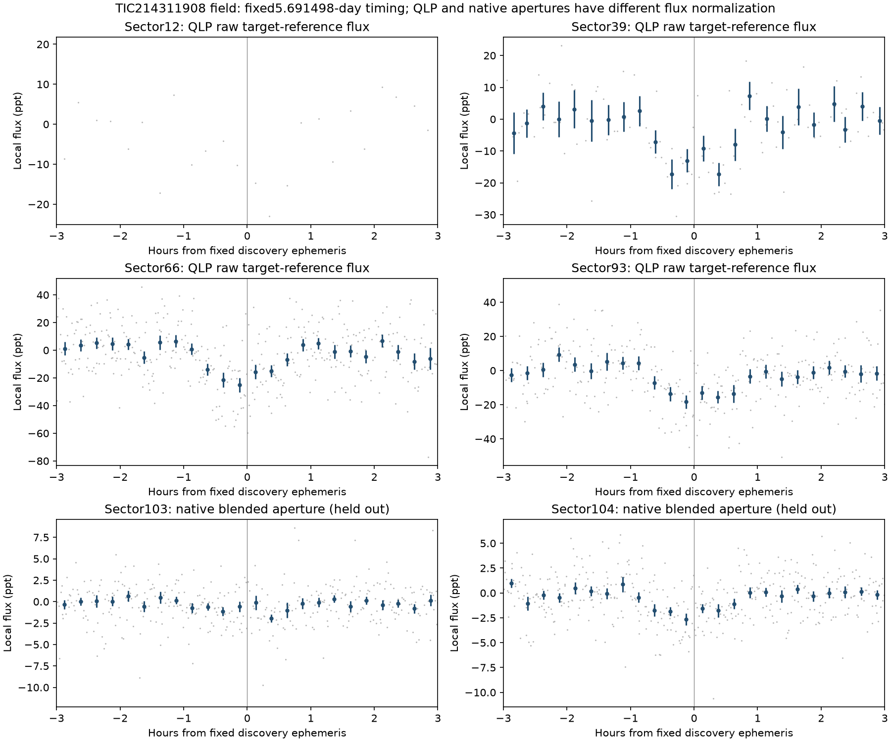
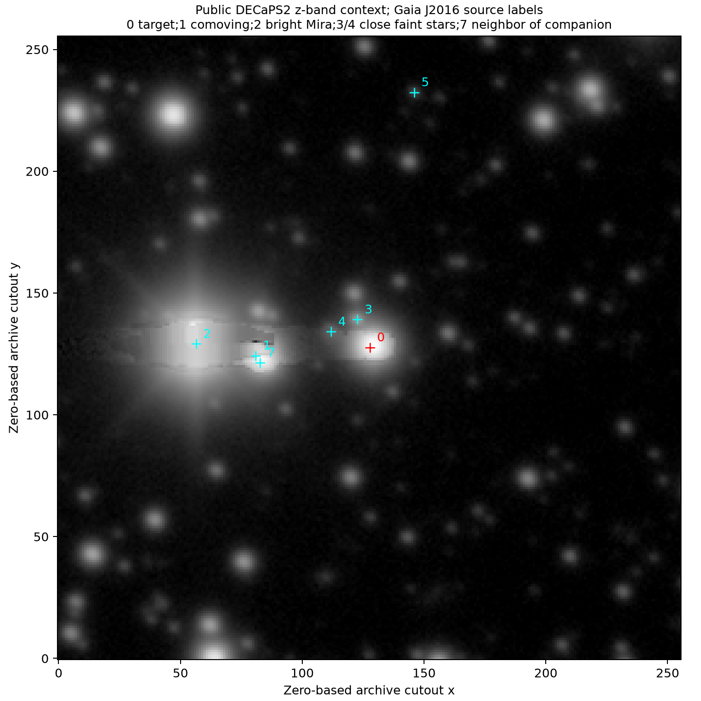

# Independent review of TIC 214311908

**17 October 2026. Assessment: a promising, recurrent transit/eclipsing signal, with the host star unresolved. No planet, discovery priority, or previously unknown star is established.**

The user requested a review without access to another model's findings. No period, plot, epoch or assessment from that model was supplied or used. The approximately **5.6915-day** signal was identified in independent searches of public observations. Two additional sectors were then tested at a frozen discovery ephemeris before examining their flux.

## What the observations support

The field contains a recurring light-loss feature with approximately **1.65-hour** duration. Original QLP data in Sectors **12, 39, 66 and 93** contain **13 sampled, positive local event windows**. They are not all individually significant. A timing fit using 12 usable midtimes gives:

- **Period: 5.691513806 ± 0.000008821 days.**
- **Reference midtime: BTJD 1632.611612 ± 0.002312, TDB.**

These are conditional, covariance-dependent uncertainties from a fitted template, not a complete systematic-error budget. A separate worker fitted only the four discovery sectors and preserved the full covariance and source-hashed method. Its timing snapshot was saved after the root analyst downloaded the held-out sectors; that worker never accessed them. The prospective test below used the earlier preregistered BLS timing, not this refined timing. See the [chronology audit](holdout/timeline_audit.json). Propagate the full covariance and allow an additional timing floor for follow-up; do not treat the listed errors as guaranteed observing windows. Barycentric TDB times require observer-specific conversion before scheduling UTC observations.

The initial broad pooled search independently found P 5.691497929 days and BTJD 1632.614684206, with diagonal BLS score 11.65 and local screening score 9.44. These selected-search scores have no calibrated global false-alarm interpretation. The shallow historical data and some event-acceptance gates weakened the initial per-sector BLS recovery; raw local tests recover older events rather than treating an empty screening statistic as a physical nondetection.

| Sector | Primary product | Raw/local depth | Conditional local S/N | Sampled positive windows |
|---|---|---:|---:|---:|
| 12 | QLP, target-reference normalization | 1.194 ± 0.514% | 2.32 | 2/2 |
| 39 | QLP, target-reference normalization | 1.270 ± 0.179% | 7.08 | 4/4 |
| 66 | QLP, target-reference normalization | 1.889 ± 0.282% | 6.70 | 4/4 |
| 93 | QLP, target-reference normalization | 1.537 ± 0.182% | 8.43 | 3/3 |
| 103 | Native FFIs, blended 1.5-pixel aperture | 0.0964 ± 0.0352% | 2.74 | 4/4 |
| 104 | Native FFIs, blended 1.5-pixel aperture | 0.1977 ± 0.0483% | 4.09 | 4/4 |

The independent local-baseline analysis gives slightly different QLP depths/errors: approximately 1.34±0.37%,1.29±0.15%,1.90±0.21%,1.61±0.20%. These are correlated checks on the same photons, not measurements to multiply together. Differences reflect event windows, baselines and noise treatment. The table above is derived directly from `raw_local_vetting.json` and the preregistered native-aperture tests; [the searchable table](measurements.csv) preserves its counting units.

**QLP and native-aperture depths must not be equated.** Official QLP difference photometry adds the expected TIC target flux to differential measurements, effectively deblending under the assumption that the target varies. Native/ELEANOR/TARS apertures contain substantial neighboring light. Multiplying the QLP depth by 1+TIC contamination ratio would generally double-correct dilution. The same observed difference can therefore be approximately 1.5% of nominal target flux but approximately 0.1–0.3% of a blended aperture.

## A genuinely separate predictive test

QLP Sectors 103/104 were excluded from the discovery search because of documented QLP timing issues. Before downloading their pixel flux, `holdout/preregistration.json` fixed the discovery ephemeris, aperture choices, sky treatment, event windows and reporting rules. Original native FFI TDB timestamps were read directly; no QLP 103/104 timestamp or photometry was applied.

Both new sectors show positive deficits at the predicted phases: **eight further sampled windows**, yielding 21 positive primary windows across the six sectors under the stated criteria. One other S103 prediction lies in a gap; it is not a nondetection. The primary 1.5-pixel aperture gives the conditional scores 2.74/4.09 above. A wider 0.07-day window gives 3.19/5.57; the strongest aperture variant is not promoted to the primary statistic. In S104 the 1.0/1.5-pixel masks contain exactly the same four pixels, so their equal results are one measurement.

Descriptive phase offsets 0.1–0.9 give no similarly strong recurring positive control in S104. In S103 the 0.1 offset is comparable to the primary and the 0.5 offset has a negative excursion around −3.2 conditional sigma. These finite controls underline residual non-Gaussian structure; they do not establish a formal false-alarm probability. The main preregistration preceded both downloads; the separate worker's refined timing snapshot did not. Neither the refinement nor a post-download timing adjustment was used for the reported predictive test.

## Checks that favor a transit interpretation

A separate analyst initially used Lomb–Scargle and raw/local fits without seeing the root search output. Raw QLP is dominated by slow, sector-dependent trends; the 5.69-day feature survives local polynomial removal and is not a strong ordinary sinusoid. All 13 discovery-sector event windows are positive in raw and corrected flux. Small/large apertures broadly preserve the sequence, although their depths differ. Older QLP SAP_X offsets are approximately 3.6–4.5 conditional sigma at only about 0.001 native pixels; recent centroid/background aggregates do not show a corresponding strong event. These small centroid diagnostics do not locate a host.

Original independent public reductions also preserve the fixed-phase feature:

- ELEANOR-LITE S12 has three positive windows: raw/corrected/PCA local scores 5.77/5.84/6.04 and blended depths approximately 0.23–0.25%.
- TARS S12/39/66/93 has 3/4/4/3 positive windows, blended depths approximately 0.19/0.26/0.32/0.28%. TARS supplies no original error or quality columns; its descriptive scores explicitly use empirical adjacent-difference errors and local residual floors.

These reductions share the original observations. They help reject a QLP-specific artifact but are not additional sectors or independent discovery probabilities. ELEANOR/TARS include an additional early event window not accepted by the primary QLP-quality/window criteria; do not add overlapping window counts as independent transits.

There is a **separate, much weaker approximately 0.15804-day modulation**, consistent with half a known 26.6 arcsec neighbor's 0.316082962-day eclipsing-binary period. The deep 5.69-day events occur at changing phases of that neighbor across years. Neither the simple 18×period proximity nor the weak short-period contamination explains the deep sequence. The other known field EB has P 0.260925849 days. Gaia EB epochs are TCB and require time-scale conversion/uncertainty propagation for exact comparisons.

## Physical fits and why this is not yet a planet

TIC 214311908 is a nearby cool dwarf: Gaia DR3 **5925373272850784768**, approximate Teff 3301 K, mass 0.369 solar, radius 0.381 solar, distance 64 pc. Those are catalogue estimates, not new spectroscopy. A circular exposure-integrated transit with the nominal TIC density fits the 13 original QLP events: radius ratio 0.121–0.124, impact parameter 0.55–0.59, contact duration 1.64–1.68 hours across three fixed limb-darkening choices. **If the signal is on this star and the reference-flux assumptions are appropriate, the implied companion radius is about 5.1 Earth radii.** This is conditional, not a measured planet radius or companion mass.

The same 1961 native-cadence samples and per-event baselines give flat-model χ² 2558.18 versus circular-transit χ² approximately 2284–2285 for 1919 degrees of freedom. The tested circular, equal-luminosity, grazing stellar binaries at twice the period fit worse by approximately Δχ² 15.7–15.9 in their best cases. Those restrictive shape comparisons favor the planet-like model, but **do not exclude unequal-star/eccentric/blended binaries or provide model odds/FPP**. Source flux, density, colour and distance are linked; an allowed free-geometry fit is not proof that a particular neighboring star has those parameters.

No convincing alternating-depth discrepancy or secure half-phase secondary is established. Their absence at these noise levels does not exclude stellar companions. The Gaia target has normal RUWE≈1.08, no published NSS solution in the checked tables, and a median RV approximately 16.3±2.2 km/s from 21 transits. The missing detailed variability statistics and lack of epoch RVs prevent using that catalogue value as a planetary mass constraint.

## The decisive unresolved issue: which star dims?

The field is severely crowded: 1031 Gaia entries within 120 arcsec, including:

| Possible contaminant | Separation in catalogue context | Relevant evidence |
|---|---:|---|
| TIC 1515709327 /Gaia 5925373272827260544 | approximately 3.15 arcsec | G17.48,T16.85; about 2.9% of nominal target T flux. An approximately 50% eclipse can mimic the observed approximately 1.5% target-normalized deficit under comparable coupling. |
| Gaia 5925373272827258752 | approximately 4.27 arcsec | G18.60,T≈17.82; very close blend. Simple flux-limit arguments need accurate PRF/coupling and photometric calibration. |
| TIC 214311910 /Gaia 5925373272850782208 | approximately 11.7 arcsec | Nearly comoving cool star; RUWE≈13.7 and complex astrometry. These flags do not identify a 5.69/11.38-day binary. |
| TIC 214311906 /Gaia 5925373268528684288 | approximately 17.8 arcsec | Bright known Mira; substantial long-term contamination, period approximately 294–326 days. |

Native S66/S93 difference images support a deficit in the central blend, with maximum selected pixel scores around 4.6–6.1 under baseline/sky variations. These are modest source-location data. Correcting Gaia proper motions shifts the old target cross by approximately 0.16–0.17 native pixels. Fixed-source comparisons cannot securely distinguish the target, close faint source and comoving companion. Conditional χ² differences are approximately 0–2 in S93, while S66 differences reach about 5.4 for the comoving companion and change preference with baseline treatment. Formal Gaussian-validity flags do not include full crowding, WCS/PRF mismatch or pixel covariance.

Resolved DECaPS2 imagery independently shows the nearby distinct sources. This rules out treating the entire TESS image blend as a single isolated dwarf. [The source-assignment report](source_localization/README.md) retains 304 conditional fits, Gaia propagation, overlays and the QLP normalization literature audit.

## Prior recognition and scope of novelty checks

Checked 17 October 2026: NASA confirmed/TOI, complete ExoFOP CTOI, target ExoFOP record, RAVEN release tables, TESS-EB, Gaia NSS/EB/rotation, VSX, SIMBAD/aliases, WDS/wide-binary tables, earlier published search tables, bounded arXiv queries, and TARS public products. No prior planet/candidate designation or matching coherent transit ephemeris was identified in this finite review. **This is not proof of novelty or priority.**

TARS light-curve presence means ordinary processing in a 39 million star-sector inventory. Its 1,046,317-row default period catalogue contains no exact TIC or Gaia match for this object. The four public light-curve headers contain broad/lower-ranked near 5.7-day sinusoidal peaks, but not the coherent 5.6915-day transit solution or a planet designation. Their floating-point Gaia identifiers lose precision; the exact Gaia archive identifier above remains authoritative. Full source responses and publisher checksums are preserved. The MAST target-name query restricted to collection TESS returns zero, while the broader all-collection query correctly identifies QLP, TARS and ELEANOR products; zero in the first query did not establish no public data.

This TIC was not in the prior broad Sector 1 or the six-sector 83/86/95/96/98/105 campaign samples. Its observed sectors differ and its Tmag 13.01 is fainter than the recent 12.5/11.5 selection limits. This targeted review is one additional nominated star, not a retroactive addition to those frozen survey counts.

## Most useful next observations

**Resolved time-series photometry during a predicted event, monitoring the target, TIC 1515709327 and TIC 214311910 simultaneously, is the most decisive next step.** Approximately 1 arcsec seeing or suitable high-resolution imaging can distinguish the 3 arcsec blend. A deep eclipse on the faint neighbor would be much easier to distinguish than a 1.5% target transit. Multicolour photometry tests stellar contamination. Spectra/RVs of the correct host would then test a stellar/brown-dwarf companion and measure mass; target-only spectroscopy could miss a background EB.

Independent PRF photometry and broader literature/alias checks can improve the archival case, but the existing TESS source localization alone cannot settle it. No external submission, message or observing request has been made. This is **a signal worth following up, not a confirmed planet or a claimed novel system**.

## Reproduction and preservation

Use `/workspace/openrouter-check-venv/bin/python`, with OMP/BLAS threads at 1 and `MPLCONFIGDIR=/workspace/tess-research-data/matplotlib`. Standalone source-hashed methods and exact queries are under `scripts/tic214311908_*.py`, `data/tic214311908/` and the linked subreports. The raw cache is `/workspace/tess-research-data/tic214311908/`. The fresh task initially had no old cache; the latest committed code was fast-forwarded and pinned dependencies reinstalled using the existing setup script. Reusable install/start instructions were saved as an environment configuration draft; they are not a published snapshot.

The target checkpoint archives all 13 original scientific TESS FITS and exact query metadata for offline restoration. After restoring a lost cache, `verify --science-only` checks science FITS, sources and artifacts without requiring redundant ZIPs or the parent TARS catalogue. The large published TARS parent table remains outside ordinary Git with its public URL, publisher MD5 and SHA256, plus exact scan results. Original ZIPs, failed responses and earlier software attempts remain retained. Cloud filesystem persistence remains unverified. See [the checkpoint instructions](../../PROGRESS.md) for current verify/restore/reproduce commands. OpenRouter research spending remains $0.
