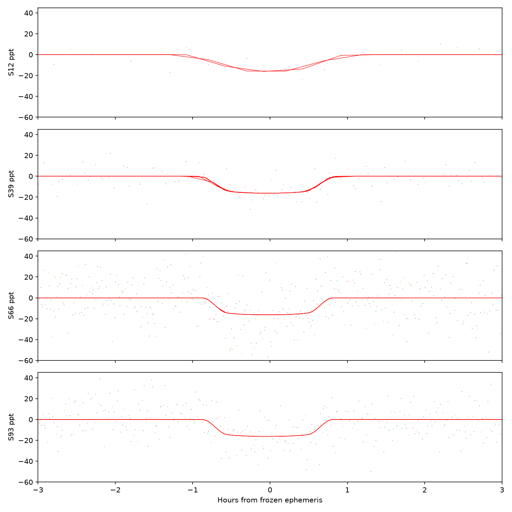

# Independent photometric assessment of TIC 214311908

Analysis date: 17 October 2026. This analyst first inspected only the original
QLP light curves from Sectors 12, 39, 66 and 93, using Lomb–Scargle rather than
the parent investigator's BLS outputs. No findings from the user's other model
were supplied or accessed. The parent investigator subsequently supplied its
independently detected 5.6915-day ephemeris and a catalogued neighboring binary
period for explicit tests. No holdout observations were accessed by this analyst.

**Conclusion:** the approximately 5.6915-day dips survive independent local
baseline fits to both original raw SAP and corrected QLP flux. They recur in all
four available QLP sectors over six years. Their shape is compatible with a
circular planetary transit under specific host and dilution assumptions, but
the source remains unassigned in this crowded field. These measurements establish
a recurrent transit/eclipsing feature, not a planet or a new stellar companion.

## Independent initial variability search

Quality-zero finite measurements were retained. Flux channels were divided by
their own median; auxiliary coordinates/background retained native units. A
Lomb–Scargle search spanning 0.05–20 cycles/day, with 15 samples per peak, found
large sector-dependent 10–14-day trends in raw SAP. Corrected flux had no large
sinusoidal variation. Its weak approximately 0.158-day modulation in Sectors 66
and 93 is consistent with half the period of the catalogued neighboring eclipsing
binary Gaia DR3 5925373272827278208, 26.63 arcseconds away, whose Gaia period is
0.3160829620 days. The strongest combined short-period LS alias is 0.1580381235
days, versus the catalogued half period 0.1580414810 days. Sparse-sector aliases
are retained in `assessment.json`.

At the catalogued half period the corrected-flux sine amplitudes are
0.941 ± 0.253 ppt in Sector 66 and 1.351 ± 0.221 ppt in Sector 93; the two older
sectors are below 1 sigma. Sector 93 has a Gaussian/Baluev broad-search LS
probability approximately 1.4e-5, but this is not calibrated for correlated noise
or spacecraft systematics. This weak periodic feature does not explain the much
deeper 5.6915-day dips. Their predicted neighboring-binary phases change from
approximately 0.38 in Sector 12 to 0.20 in Sector 39, 0.02 in Sector 66 and 0.84
in Sector 93. Near-integer period proximity alone is not an identification.

## Original-flux event measurements

The parent BLS proposal was P = 5.691497928943136 days, T0 = 1632.6146842062005
BTJD, duration = 0.0495833333 days. At this fixed proposal, each sampled event
was measured in an independent ±0.30-day window. A quadratic baseline was fitted
outside ±0.85 durations, with iterative four-MAD clipping restricted to the
baseline. The event depth is the negative mean residual inside half a duration,
relative to the locally fitted baseline. Error estimates include a diagonal
baseline-fit covariance and local scatter; they do not capture correlated noise.

| Sector | Sampled events | Raw SAP depth | Corrected depth | Small-aperture depth |
|---|---:|---:|---:|---:|
| 12 | 2 | 1.344 ± 0.373% | 1.383 ± 0.386% | 1.482 ± 0.297% |
| 39 | 4 | 1.292 ± 0.150% | 1.293 ± 0.154% | 1.256 ± 0.111% |
| 66 | 4 | 1.903 ± 0.210% | 1.842 ± 0.208% | 1.341 ± 0.154% |
| 93 | 3 | 1.613 ± 0.195% | 1.625 ± 0.189% | 1.423 ± 0.144% |

All **13 sampled predicted events** have positive raw and corrected depths.
This total includes four Sector 39 events not counted by the automated screening
event gate, and a Sector 66 event at BTJD 3106.71265 with raw depth
2.70 ± 0.44% and corrected depth 2.66 ± 0.46%. Sector 12 has only two
30-minute samples per event in the fixed depth window, so its individual depths
and shapes are poorly resolved. The automated six-event summary, the thirteen
manually measured events, and the twelve fitted timings below describe different
selection/measurement steps and must not be added together.

Recent-sector background and centroid aggregates show no significant matching
dip. Older sectors show a small SAP_X shift toward increasing detector x:
0.000959 ± 0.000267 pixel in Sector 12 and 0.000996 ± 0.000221 pixel in
Sector 39. SAP_Y is insignificant. These conditional coordinate shifts may
reflect blending or systematics and require a WCS/source model before a sky
interpretation. The aperture-dependent depths, especially in Sector 66, also
require explicit blending checks. A catalogued TIC contamination ratio is not
an independently measured dilution factor for these QLP light curves.

## Separate discovery-only ephemeris

An exposure-integrated trapezoid with a simultaneous quadratic local baseline
was fitted to individual corrected-flux events. The ingress and egress each
occupy 20% of the total duration. All events were allowed their own depth,
midpoint and duration. The weak first Sector 12 event broadened to about 3.7 hours
and was excluded from timing regression; its measurement remains in the table.
The other twelve timings yield:

- T0 = **1632.6116121252 ± 0.0023121808 BTJD**.
- P = **5.69151380593 ± 0.00000882104 days**.
- Timing chi-square = **17.2184 for 10 degrees of freedom**.

These are conditional diagonal errors. `ephemeris_frozen_pre_holdout.json`,
created at 13:47:03 UTC, preserves the full parameter covariance, a covariance
inflated by chi-square/ndof, method snapshot and input-output hashes. A
five-milliday additional timing-noise allowance and a minimum ±0.020-day
center tolerance were proposed by this analyst, who never accessed the held-out
observations. Root had already retrieved those sectors at 13:46:28/35 UTC.
Thus this snapshot is discovery-only, but is not a global pre-retrieval freeze.
The main holdout test instead used the original BLS timing preregistered at
13:46:21 UTC. The original snapshot wording and filename remain unchanged;
see the [chronology audit](../holdout/timeline_audit.json).
The later circular shape fit below does not replace this frozen proposal.

## Conditional circular transit shape

`circular_shape.py` fits exposure-integrated batman models to all thirteen
corrected-flux local windows, 1,961 native cadences, marginalizing over an
independent quadratic baseline for every event. It fixes the circular period to
the frozen proposal and the stellar density to the TIC value, 9.445379 g/cm³
(mass 0.369492 solar masses and radius 0.380658 solar radii), giving
a/Rstar = 25.2898. It tests three fixed quadratic limb-darkening choices and
fits one common radius ratio, impact parameter and small global epoch offset.

The fits give k = 0.1212–0.1240, b = 0.547–0.594 and total duration
1.64–1.68 hours. Baseline-only chi-square 2558.18 falls to 2283.80–2285.23
for 1,919 residual degrees of freedom. This conditional improvement is not a
survey-wide false-alarm probability. Under the on-target, no-extra-dilution
assumption, the fitted radius would be approximately 5.03–5.15 Earth radii.
Unknown dilution, a background eclipsing source, unresolved companions,
correlated noise and stellar-parameter uncertainties prevent treating that
number as a measured planetary radius. No mass is inferred. The exercise shows
that the duration and shape do not geometrically disprove a circular planet.



## Files and reproduction

- `assessment.json`: original input identities, independent LS peaks, per-channel
  fits, all event measurements, free event shapes and timing assessment.
- `local_event_measurements.csv`, `local_event_sector_summaries.csv`,
  `exploratory_event_shapes.csv`: searchable quantitative outputs.
- `ephemeris_frozen_pre_holdout.json`, `ephemeris_method_snapshot.py`: immutable
  discovery-only proposal and method snapshot, with original filenames preserved.
- `circular_shape_assessment.json`, `circular_shape.py`: separate conditional
  physical-shape calculation and its assumptions.
- `original_lightcurves.png`, `independent_phase_folds.png`: overview figures;
  the broad whole-period phase bins dilute narrow 5.69-day dips and are not
  the resolved transit diagnostic.
- `combined_corrected_arrays.npz`: original median-normalized corrected samples,
  per-sector scatter estimates and short-period LS grid, not BLS detrended data.

Run from the repository with the astronomy virtual environment and raw files
listed in `data/tic214311908/observations.json`:

```bash
OMP_NUM_THREADS=1 OPENBLAS_NUM_THREADS=1 MPLCONFIGDIR=/workspace/tess-research-data/matplotlib /workspace/openrouter-check-venv/bin/python scripts/tic214311908_variability.py
OMP_NUM_THREADS=1 OPENBLAS_NUM_THREADS=1 MPLCONFIGDIR=/workspace/tess-research-data/matplotlib /workspace/openrouter-check-venv/bin/python candidates/tic214311908/independent_variability/circular_shape.py
```

Rerunning the first command updates its ordinary timestamped outputs. The
separate timing JSON and method snapshot must remain preserved.
