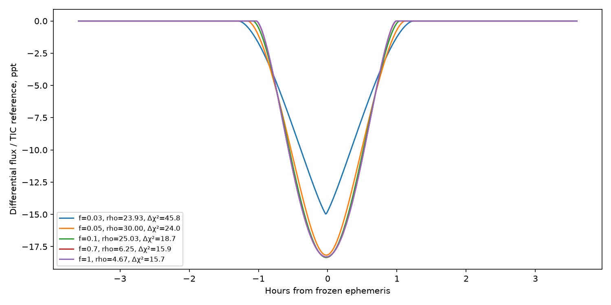

# Bounded stellar-eclipse alternatives

Analysis date: 17 October 2026. No holdout observations were accessed. The
existing circular fit and discovery-only timing proposal remain unchanged.
See the [chronology audit](../../holdout/timeline_audit.json) for the distinction
between that worker-local snapshot and root's earlier holdout preregistration.

**Result:** the original QLP data prefer the previous circular dark-transit
shape over this restricted equal-star family, by conditional delta chi-square
approximately 16 for the best alternatives. Grazing equal-star models at twice
the dip period nonetheless reproduce the broad depth and duration using
stellar densities in the searched range. This test does not establish that
these alternatives are excluded, identify the host, or yield a false-positive
probability. It also does not demonstrate that a particular catalogued neighbor
has the required stellar properties.

## Normalization and geometry

The dip period is the frozen 5.69151380593 days; the stellar binary's true
circular orbit is twice that, 11.38302761185 days. Both stars have identical
radii, masses, luminosities and quadratic limb darkening, so their alternate
eclipses have identical shapes. Batman is used with radius ratio one, but the
physical separation uses both stellar masses:

`a/R = [2 G rho (2 P_dip)^2 / (3 pi)]^(1/3)`.

Each local window is centered on its conjunction while retaining the 2P orbital
velocity in the exposure-integrated model. The foreground star contributes
constant light; limb darkening applies to the eclipsed star. If B(t) is the
blocked fraction of one star and f is the **total binary reference flux divided
by the TIC target reference flux**, the predicted differential flux is
`-f B(t)/2`. Its maximum possible depth is f/2. The coefficient would be
different for aperture-total normalization; this calculation explicitly uses
the QLP target-reference/difference-flux interpretation. No catalogued
`1 + contamination` multiplier is applied.

The flux ratio f must ultimately account for color, extraction throughput and
QLP normalization. In particular, f=0.7 is near the catalogued reference-flux
ratio of TIC 214311910 to the target, but this resemblance does not establish
that the neighbor is an equal-star binary or has the required density. For a
physically associated pair, stellar luminosity, color, density and distance
cannot be chosen independently. Those source-specific constraints are outside
this bounded calculation.

## Matched data and fitting

The input selection, native exposure integration, local noise estimates and
event-specific quadratic baselines are identical to the earlier circular fit:
13 events, 1,961 samples, Sectors 12/39/66/93. The code asserts exact point/event
counts and baseline-only chi-square equality to 1e-9. Linear baseline parameters
are marginalized by least squares at each nonlinear trial.

Five reference flux ratios were searched, f = 0.03, 0.05, 0.1, 0.7 and 1. At
each ratio six fixed stellar densities, 0.1/0.3/1/3/10/30 g/cm³, were tested with
free impact parameter and epoch shift. The three best grid results then started
a continuous density fit bounded to 0.1–30 g/cm³. The limb-darkening coefficients
were fixed at [0.35, 0.25], matching the directly compared circular fit. The
circular model fits radius ratio, impact and epoch; the continuous-density
stellar models fit density, impact and epoch, so all have 1,919 residual degrees
of freedom. The stellar density is a conditional free parameter rather than an
externally measured source property.

| Total binary flux / TIC reference | Best density (g/cm³) | Impact b | Total duration | Chi-square | Delta chi-square vs circular model |
|---:|---:|---:|---:|---:|---:|
| 0.03 | 23.93 | 0.000 | 2.52 h | 2330.39 | +45.83 |
| 0.05 | 30.00 | 0.480 | 2.27 h | 2308.53 | +23.97 |
| 0.10 | 25.03 | 1.050 | 2.12 h | 2303.24 | +18.68 |
| 0.70 | 6.25 | 1.718 | 2.02 h | 2300.47 | +15.91 |
| 1.00 | 4.67 | 1.773 | 2.01 h | 2300.29 | +15.73 |

The directly matched circular model has chi-square 2284.56, versus baseline-only
2558.18. The first two stellar fits encounter the central-impact/density bounds;
they should not be interpreted as well constrained optima. The free-source
densities at f=0.7 and f=1 are stellar values, and their impact parameters describe
grazing configurations. Their rounder profiles fit less well than the flatter
circular dark-transit model under the fixed assumptions. Delta chi-square is a
conditional diagnostic, not a calibrated likelihood ratio or detection sigma:
the noise is not established to be independent Gaussian noise, stellar limb
darkening is fixed, and many astrophysical alternatives are not included.

Unequal stellar components, eccentricity, different limb darkening, additional
third light, spots and source-dependent normalization remain untested here.
Rejecting this symmetric family would not reject those possibilities.



## Files and reproduction

- `fit_stellar_alternatives.py`: complete method, source hash included in output.
- `stellar_alternatives.json`: assumptions, full grid/continuous results and
  direct circular comparison.
- `stellar_alternatives.csv`: searchable model table.
- `original_window_inputs.npz`: exact selected fluxes, times, scatter estimates,
  event/sector identities and baseline design used in the calculation.

```bash
OMP_NUM_THREADS=1 OPENBLAS_NUM_THREADS=1 MPLCONFIGDIR=/workspace/tess-research-data/matplotlib /workspace/openrouter-check-venv/bin/python candidates/tic214311908/independent_variability/stellar_alternatives/fit_stellar_alternatives.py
```
