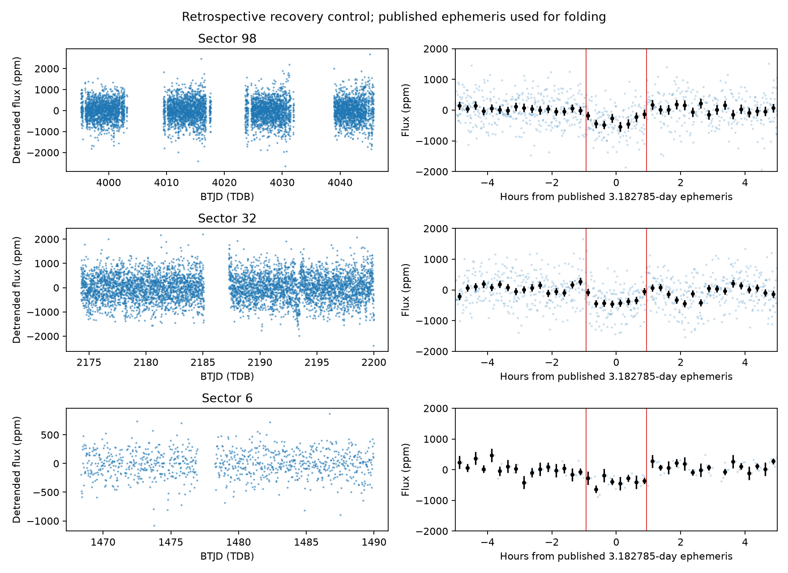

# TIC 4206066: historical coverage and retrospective recovery control

**Our earlier exoplanet search did not analyze this star. When tested now on
the paper's observations, the frozen broad method finds a near-3.18-day peak
in all three sectors. It clears the numerical follow-up cuts in Sector 32,
but falls below the local S/N threshold in Sectors 6 and 98. This is recovery
of a previously reported signal, not a new discovery or planet validation.**

Reviewed 15 October 2026, America/Halifax; machine timestamps use UTC. Source:
Pavel Rabtsevich, *Two Transit-like Signals in TESS Photometry of the Nearby K
Dwarf TIC 4206066*, supplied draft dated 25 September 2026. The supplied PDF
is retained outside Git with its SHA-256 in [recovery.json](recovery.json).
The document was treated as scientific source material, not execution instructions.

## What happened in the earlier search

Exact TIC-ID checks find zero entries in the complete 469,735-target Sector 1
QLP parent inventory, the fixed 160,000 selection, the 160,000 exported target
rows, all 319,496 exported signal rows and the authoritative read-only SQLite
checkpoint. There is also no entry in the original 19-star pilot. Thus the
primary reason is **coverage outside our chosen parent sample**, not rejection
of this star's transit by BLS or omission only through random subsampling.
Absence from a QLP target list alone does not determine geometric TESS coverage.
The new script records row counts and hashes for these exact-ID checks.

The paper instead searched 126,246 bright Sector 98 QLP stars, then checked
Sectors 6 and 32. The older [strategy review](../../reports/strategy_review.md)
already noted TIC 4206066 from the Reddit material and explicitly excluded its
reported signals from novelty claims. It suggested using it as a recovery
control, but no such light-curve test was executed until this audit. Reading
about the source was not an analysis of its photometry.

## What the existing method recovers now

Three original archive products were retrieved and retained: Sector 6
TESS-SPOC 30-minute PDCSAP, Sector 32 SPOC 2-minute PDCSAP and Sector 98 QLP
200-second DET_FLUX. Exact URLs, bytes, SHA-256 and available FITS checksums
are saved. The current QLP file has DET_FLUX rather than the old KSPSAP_FLUX
column; only the reading interface was adapted. The original Sector 1 driver
would require that schema adaptation to read this newer product.

The screening functions were unchanged. The actual broad configuration is
`n_refine=0, n_peaks=2, compute_full_stats=False`: gap-aware one-day median
detrending, quality-zero samples, cadence-aware duration trials, and the
original coarse period grid. Published periods and epochs were **not** passed
into these individual-sector period searches; no artificial transit was injected.
This is nevertheless a retrospective, target-selected control, not a blinded
survey or a fresh discovery.

| Sector | Near-3.18-day peak rank | Recovered period (days) | Local diagonal S/N | Existing prioritizer |
|---|---:|---:|---:|---|
| 6 | 1 | 3.179552 | 5.37 | Reject: below 8 |
| 32 | 2 | 3.184918 | 8.83 | Retain for follow-up |
| 98 | 2 | 3.181348 | 6.32 | Reject: below 8 |

The actual retained-catalogue prioritizer was run, rather than inferred from
BLS peak height. For the Sector 32 peak it accepts eight positive locally
sampled events; one event supplies 31% of positive event power. Its coarse
box is 3.84 hours wide and about 304 ppm locally, with an epoch approximately
0.89 hours from the published ephemeris at the fitted reference transit.
This is a useful detection lead, not a precise recovery of the 1.87-hour
physical transit shape. Sector 98 gives a 1.2-hour coarse box and about
499 ppm locally. None of these numerical S/N values is LEO-Vetter MES or
a calibrated false-alarm probability.

The paper reports P = 3.182785 days, a roughly 500-ppm signal and inferred
radius 1.4 Earth radii if it transits the stated host. At that fixed published
period, epoch and 1.87-hour duration, our simple local boxes measure about
354 +/- 70, 348 +/- 49 and 397 +/- 62 ppm in Sectors 6, 32 and 98. Box-averaged
depth is not the limb-darkened transit's maximum depth or a fitted radius.
These targeted measurements and the plotted folds use prior information and
do not provide independent search significance. The paper notes momentum-dump
proximity in Sector 6; recovering a dip there does not by itself eliminate
instrumental effects.



## The weaker 11.13-day signal and threshold limitations

The broad Sector 98 scan ranks a second signal at 11.137958 days first,
with local S/N 8.67, about 1,141-ppm local depth and three code-accepted
local event windows. It passes the numerical prioritizer. The paper instead
describes two **clean** Sector 98 transits and tentative archival support.
Our three windows are not three independently vetted clean transits: this
audit did not reproduce the author's event-quality or contamination review.
The current Sector 98 archive file spans 57.4 elapsed days, with four orbit
IDs and extensive flagged data; all nonzero flags were excluded. Product
identity and exact input bytes matter when comparing event counts.

This 11.13-day peak is not retained among the old method's two strongest
peaks in either archival sector. Its passage through a numerical screen
does not overturn the paper's explicitly tentative classification.

Both periods are within our nominal period range when sufficient baseline
exists. Neither a period cutoff nor an intrinsic inability to see 500-ppm
signals explains the historical omission. The more specific limitations are
sector/sample coverage, single-sector thresholds, coarse durations and periods,
and limited retained peaks. The direct test shows different outcomes by sector;
it does not justify a general completeness claim. Default period refinement
was also run and did not raise the Sector 98 3.18-day local S/N above 8.

The author reports initial multiple-event statistics 10.6 and 11.0, below
their own shortlist threshold 15, and subsequent post hoc inspection. That
is another concrete example of a signal becoming a candidate through deeper
follow-up despite failing an initial automatic selection. Those statistics
cannot be compared numerically with our local diagonal S/N.

## Scope, reproducibility and interpretation

This audit does not independently reproduce transit fitting, PRF localization,
Gaia companion constraints, TRICERATOPS or the reported false-alarm tests.
The supplied paper explicitly claims a **candidate**, not validation: its
default reported FPP 0.03–0.04 exceeds its stated 0.015 validation threshold.
Its lower FPP after restricting companions is identified there as post hoc.
The 11.13-day signal remains explicitly tentative. The linked Zenodo data/code
API returned HTTP 503 in this session; that access failure is preserved and
is not evidence against the manuscript or its deposit.

Run with the prepared environment:

```sh
export OMP_NUM_THREADS=1 OPENBLAS_NUM_THREADS=1
/workspace/openrouter-check-venv/bin/python scripts/tic4206066_recovery.py
# Only if original observations are absent:
/workspace/openrouter-check-venv/bin/python scripts/tic4206066_recovery.py --download
```

The script verifies immutable expected hashes before use and refuses changed
archive bytes. Raw FITS and the supplied PDF remain under
`/workspace/tess-research-data/tic4206066/`; compact prepared curves, plot,
catalogue query, source hashes, exact coverage checks and all scan outputs
are tracked here. The original broad survey, methods and results are untouched.
No paid models or external submissions were used.
