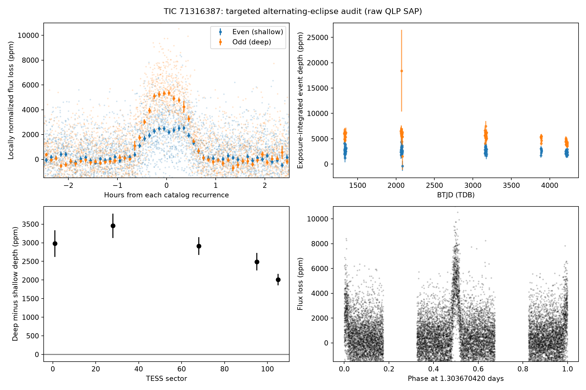

# TIC 71316387: validation of an alternating-eclipse claim

Checked 2026-10-14 UTC. **The claim has strong observational merit: alternating deep and shallow eclipses recur in five TESS sectors, favoring an eclipsing system with a period about 1.30367 days. The exact quoted depths of 5,293/2,487 ppm and 19.6σ have not been independently reproduced. This is evidence for a binary interpretation, not a confirmed stellar-mass binary or a new exoplanet.**

## Catalog status and published analysis

The current [ExoFOP entry](https://exofop.ipac.caltech.edu/tess/target.php?id=71316387) lists CTOI 71316387.01 as `PC`, uploaded on 2026-08-27, with the note “High-probability planet with RAVEN.” Its candidate period is 0.6518369465110034 days. It does not belong to RAVEN's validated-planet table. The published target score is 0.930955, defined as the minimum of separate planet-versus-false-positive classifier probabilities; it is not a joint posterior against all false-positive scenarios.

The [RAVEN target summary](https://exofop.ipac.caltech.edu/tess/get_file.php?id=1113786) used sectors 1 and 28, and reports a single-period transit-model depth of 5,494.6 ± 1,338.5 ppm. RAVEN explicitly includes odd/even depth and duration features and examines harmonic aliases. These results warrant revisiting this target's classification, without asserting that the original method omitted those tests. Exact published rows, original PDF, retrieval details and finite prior checks are in [catalog/README.md](catalog/README.md).

## Independent remeasurement

We analyzed the original public QLP light curves in sectors 1, 28, 68, 95 and 105, with 30-minute, 10-minute and 200-second integration times. A public MAST query for target-named SPOC two-minute curves returned no observations. The sector 1 product already existed in the retained broad-survey cache, where this signal was correctly categorized as a known-period control rather than a novel candidate. The additional products were retrieved and retained; sector 106's requested QLP product returned 404.

The primary audit uses QUALITY=0 data, independent out-of-eclipse quadratic baselines, an exposure-integrated trapezoid, and per-event fits. The eclipse shape and timing ephemeris are estimated from these data. Separate sector mean depths absorb changing extraction/dilution; the alternating coefficient is common across sectors. Errors use the larger of event-scatter-inflated diagonal covariance and sector-cluster covariance. There are only five clusters, so the standardized contrast must not be read as a calibrated extreme Gaussian tail probability.

| Raw QLP SAP measurement | Shallow depth (ppm) | Deep depth (ppm) | Deep − shallow (ppm) | Contrast / estimated error |
|---|---:|---:|---:|---:|
| Sector 1, 24 events | 2,639 | 5,617 | 2,978 ± 357 | 8.33 |
| Sector 28, 30 events | 2,534 | 5,991 | 3,458 ± 328 | 10.53 |
| Sector 68, 32 events | 2,728 | 5,641 | 2,913 ± 240 | 12.16 |
| Sector 95, 16 events | 2,597 | 5,088 | 2,491 ± 237 | 10.50 |
| Sector 105, 32 events | 2,229 | 4,239 | 2,010 ± 152 | 13.20 |
| Five-sector common contrast, 134 events | 2,444 | 4,910 | 2,466 ± 286 | 8.64 |

Absolute depths depend on the extraction, dilution, event weighting and shape model. The five-sector displayed depths combine sector means with a common contrast; they are not an assertion that all sectors have the same amplitude. Observed depth changes are preserved rather than averaged away without an uncertainty allowance.

Sectors 1 and 28 alone give a common contrast of 3,244 ± 242 ppm. The later sectors, which were not used in the RAVEN summary, separately give 2,309 ± 271 ppm. All five sectors have the same alternating sign. The conservative common-contrast result remains positive after omitting any sector and after replacing the quadratic baseline with constant or linear baselines. Raw, corrected, small and large QLP apertures all show the same sign; their shared images mean these are sensitivity checks, not independent datasets.

The fitted recurrence period is 0.651835210 ± 0.000000211 days, with conditional fixed-shape timing uncertainty. The doubled period is 1.303670420 days. Deep events occupy one phase and shallow events the opposite phase at that period. “Odd” and “even” depend on the arbitrary epoch; the physical distinction is deep versus shallow. The timing fit has 99 accepted individual timings, while the depth fit uses 134 events; these are different coverage/significance selections.

Sector 105's supplied uncertainty column is entirely NaN. We explicitly substituted a robust first-difference noise scale, then applied local out-of-eclipse and residual-scatter floors. Excluding this sector still leaves consistent alternating eclipses in the four earlier datasets; it is not necessary for the conclusion.

## What the 19.6σ claim establishes

The quoted contrast is 2,806 ppm; 19.6σ implies a difference error of 143.2 ppm. Those values are plausible for a particular extraction and formal error definition. We cannot certify that exact calculation without its source light curve, masks, depth definition and covariance treatment.

Our primary fit has a formal diagonal contrast error of 98.0 ppm and a scatter-inflated diagonal error of 106.6 ppm, but its sector-cluster allowance raises the adopted error to 285.6 ppm. Thus a high formal significance and a more conservative standardized contrast can coexist. The numerical 19.6 must not be converted into an astrophysical false-positive probability.

A [second implementation](independent_audit.py) fits separate eclipse shapes with simultaneous per-event quadratic baselines and finite exposure integration, without importing the broad-survey routines. It measures 136 events and 60 complete adjacent pairs. Its unweighted raw pair contrast is 3,179 ± 230 ppm; a four-pair block bootstrap gives a 95% interval of approximately 2,753–3,709 ppm. Its inverse-variance pair result is approximately 2,758 ± 113 ppm using scatter-inflated diagonal errors, or ±293 ppm after allowing sector covariance (9.40 conditional standard errors). One poorly constrained sector 28 event materially affects the unweighted mean; it remains in the preserved evidence, with weighting and largest-error sensitivity reported separately. These differences illustrate why no single significance number is universal. Both implementations support the alternating signal.

The primary implementation's deterministic controls inject equal-depth and quoted alternating-depth trapezoids at the actual timestamps, integration times and gaps. Recovered contrast biases are below 1 ppm. These controls test integration/parity bookkeeping, not full real-noise false-alarm rates or survey completeness. This audit tests a specifically named prior claim; it does not report a blind discovery significance.

## Source attribution and interpretation

Independent sector 28 [difference images](pixels/README.md) place both eclipse types near TIC 71316387. The empirical centroid offsets are about 2.5 and 1.1 arcseconds, while the closest resolved neighbor is 18.19 arcseconds away. All 300 event/block bootstrap centroids per eclipse type favor the target neighborhood over that neighbor. Changing baseline/pointing regressors and fitting regions supports the same neighborhood, but the empirical Gaussian model is not a calibrated TESS PRF. An unresolved binary or blend remains possible.

Persistently unequal alternating eclipses are difficult to reconcile with ordinary identical transits every 0.65184 days. Primary and secondary eclipses of a luminous companion every approximately 1.30367 days provide a natural explanation. A shallow eclipse nearly half as deep as the deeper eclipse is a substantial warning against a normal dark-planet model. These observations do not measure the companion mass, exclude every exotic planetary interpretation, or identify components of an unresolved system. Spectroscopic velocities and resolved follow-up would be needed for a firm physical classification.

Finite checks of Gaia, VSX, the retained TESS EB catalog, SIMBAD and selected literature aliases found no established EB classification for this source. That absence is not a novelty determination. Gaia has normal RUWE but a high multiple-peak fraction; its published RV constancy statistic does not establish a significant orbit. No catalog disposition was changed and no observer was contacted.

## Reproduce and preserve

With the dependencies in the repository's `requirements.txt`, from the repository root:

```sh
export TESS_DATA_DIR=/workspace/tess-research-data
export MPLCONFIGDIR=/workspace/tess-research-data/matplotlib
export OMP_NUM_THREADS=1 OPENBLAS_NUM_THREADS=1
python scripts/tic71316387_retrieve.py --download
python src/validate_71316387.py
python candidates/tic71316387/independent_audit.py
python scripts/tic71316387_pixels.py --bootstrap 300
python scripts/tic71316387_catalog.py --large-papers
```

The original five QLP files total 2,355,840 bytes. They remain outside Git, with immutable URLs/hashes in [observations.json](observations.json). The retrieval command downloads only missing products, verifies original hashes, and preserves changed archive responses for diagnosis. Analysis supports a restored cache under `TESS_DATA_DIR/tic71316387/observations/`. Pixels retain full FFI identifiers and raw/scientific checksums. Large original paper/source files remain outside Git with retrieval manifests; derived scientific evidence is committed here. Fresh-environment cache persistence is not assumed.

Measurements: [validation.json](validation.json), [event_depths.csv](event_depths.csv), [independent_audit.json](independent_audit.json). No paid API calls were used for this audit. Next useful work is spectroscopic/resolved classification and examination of the original quoted calculation, not repeating a broad planet search on this already reported signal.


