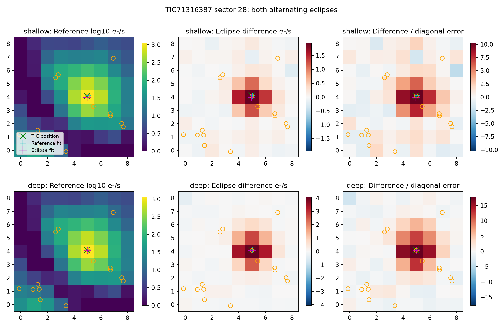

# Independent pixel check of TIC 71316387's alternating eclipses

Checked 2026-10-14 UTC using the original sector 28 full-frame observations.
Both alternating eclipse difference images peak near TIC 71316387. This favors
an eclipsing source on or close to the target over the closest resolved catalog
neighbor, while leaving an unresolved binary or blend possible.

The retained 9×9 TessCut cube contains 3,464 native 10-minute cadences; 2,600 have
QUALITY=0 and finite pixel flux/error. All three FITS HDU checksums pass the raw
ones-complement integrity check. The target lies on science silicon in camera 1,
CCD 1. Local simultaneous quadratic baselines plus finite-exposure eclipse
templates yield 16 well-covered shallow events and 12 deep events. Event windows
require baseline coverage on both sides of each eclipse.

| Eclipse | Centroid offset from TIC position | Offset from reference-image Gaussian | Events |
| --- | ---: | ---: | ---: |
| Shallow | 0.119 pixel, approximately 2.5 arcsec | 0.161 pixel | 16 |
| Deep | 0.054 pixel, approximately 1.1 arcsec | 0.072 pixel | 12 |

The closest resolved Gaia source, `6571343844562758144` (TIC 71316388), lies
18.19 arcsec from the Gaia host, approximately 0.93 pixel from the TIC position.
All 300 whole-event plus synchronized five-cadence residual-block bootstrap
centroids for each eclipse fall closer to the TIC position than to that neighbor.
Fixing the empirical Gaussian at the neighbor increases diagonal-error χ² by
202 for the shallow image and 559 for the deep image, versus the free source.
Those values are model diagnostics, not calibrated source probabilities.

Adding sky/background or empirical pointing regressors moves the fitted shallow
centroid by less than 0.006 pixel and the deep centroid by less than 0.013 pixel.
Changing the source fitting radius from 2 to 3.5 pixels gives offsets from the
reference centroid of 0.161–0.180 pixel for the shallow image and 0.069–0.178
pixel for the deep image. These model sensitivities limit precision and prevent
interpreting a subpixel offset as proof of a distinct source. The small cutout
has no independent bright registration star, so pointing regression is only a
sensitivity check. Gaia positions have not been proper-motion propagated.

The integrated elliptical Gaussian is an empirical model, not a calibrated TESS
PRF/scene fit. The bootstrap omits WCS and PRF systematics; it does not exclude
close companions. These images support a common source neighborhood for the
two eclipse types and do not establish stellar masses or confirm binarity.

Reproduce with:

```sh
OMP_NUM_THREADS=1 OPENBLAS_NUM_THREADS=1 \
  /workspace/openrouter-check-venv/bin/python scripts/tic71316387_pixels.py --bootstrap 300
```

[raw_manifest.json](raw_manifest.json) records the public retrieval URL, raw and
scientific-array SHA-256 hashes, timing/WCS information, processing version and
local cache path. Raw pixels remain outside Git at
`/workspace/tess-research-data/tic71316387/pixels/`. A regenerated TessCut file
may have different generated header bytes; the script refuses a changed raw hash
rather than silently replacing the preserved expectation. Compare scientific
arrays and WCS separately before accepting a regeneration.

[pixel_vetting.json](pixel_vetting.json) contains per-event coverage, source
measurements and bootstraps. The compressed difference files preserve every
event image and error estimate; [roi_sensitivity.csv](roi_sensitivity.csv) and
[gaia_pixel_positions.csv](gaia_pixel_positions.csv) preserve spatial checks.
[ffi_product_identifiers.txt](ffi_product_identifiers.txt) lists the original
FFI products used by TessCut.


