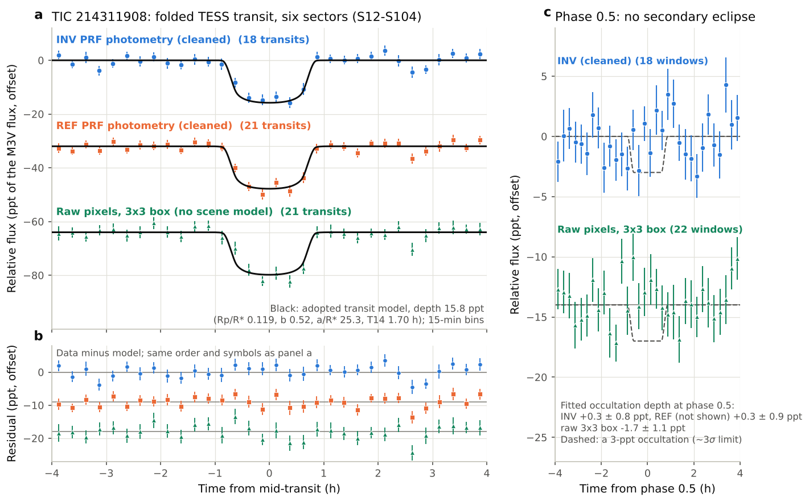
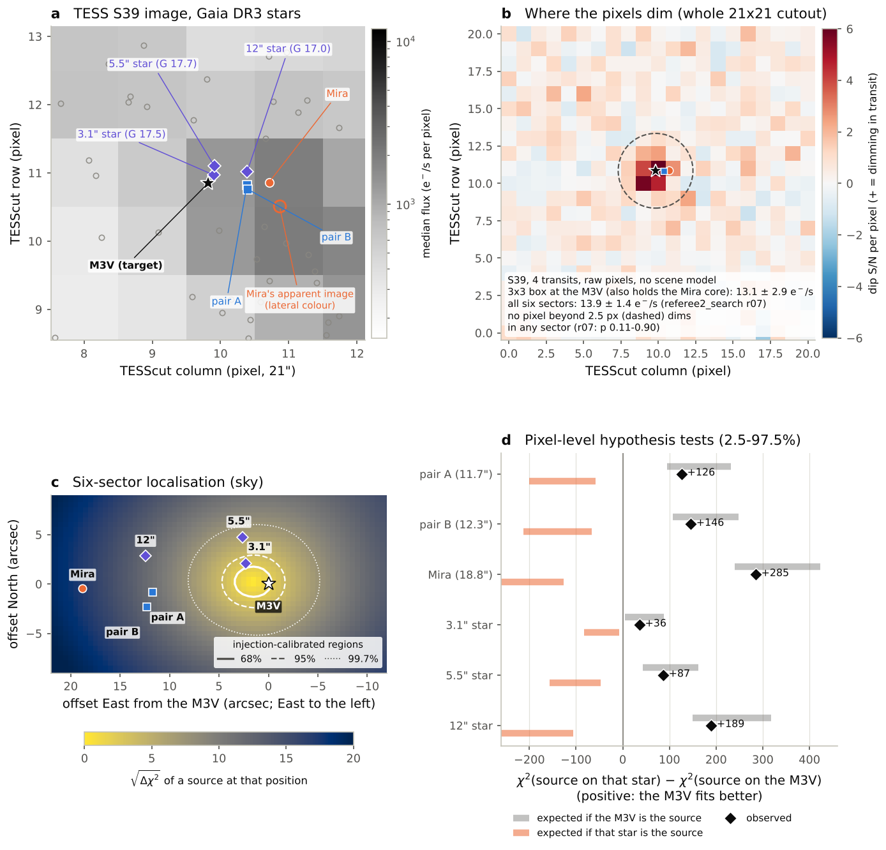
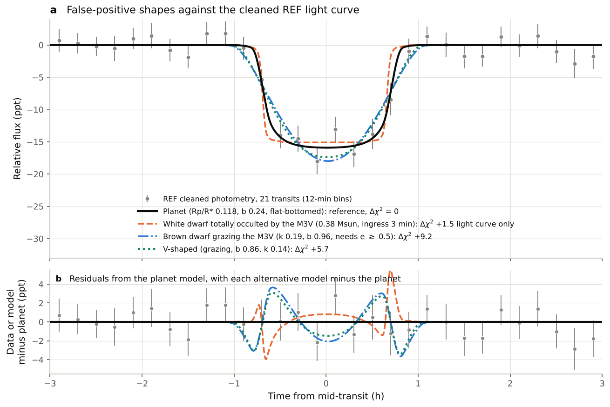

# TIC 214311908: a super-Neptune planet candidate next to a Mira

*Status, 2026-10-17: analysis complete, follow-up not started. Eleven investigations ran in three phases, and an
adversarial referee checked each one by re-deriving its key numbers with separate code. Where a referee corrected a
number, the corrected value is used here; a later phase overrides an earlier one. Three AI reviewers then checked this
write-up ([`review_log.md`](review_log.md)). AI-run analysis; it has not been reviewed by a professional astronomer.
Nothing has been submitted anywhere: no TOI or CTOI, no ExoFOP note, no paper.*

## In one paragraph

Every 5.6915 days, TESS sees the M3 dwarf TIC 214311908 (Gaia DR3 5925373272850784768, 64.3 pc away) dim by 1.6% for
1.7 hours. The dip is flat-bottomed and appears in all six TESS sectors that cover the star (2019–2026). It was first
found in the light curve of the Mira variable TIC 214311906, 17.8″ to the east, which cannot host it. Two deblending
pipelines and a model-free sum of raw pixels show the dip in every sector and confine it to the pixels holding the M3
dwarf and the Mira (no pixel more than 2.5 px, ~50″, away dims). Injection-calibrated fits of the transit images, in two
separate codes, put it on the M3 dwarf and exclude the Mira, the bound M-dwarf pair 11.7″ away and the 5.5″ star. A
faint star 3.1″ away lies inside the 95% pixel region; its own pixel test disfavours it, and its colours and the transit
shape rule it out. On the M3 dwarf the transiting body is **4.95 ± 0.24 (stat) +0.25/−0.18 (sys) R⊕**: a planet a little
larger than Neptune (1.3 Neptune radii) on a 0.045-au orbit, at about 470 K. Every eclipsing-binary explanation that was
modelled is strongly disfavoured. Both false-positive codes had a sign error; once it was fixed, the Bayesian
false-positive probability (FPP) is **0.0013–0.0033**. Most of that is a planet on a hypothetical unresolved companion
star, which would still be a planet. This is a **strong planet candidate, not a statistically validated planet**: there
is no ground-based detection and no high-resolution imaging, and on the stricter definition of the standard validation
tool the FPP (0.005–0.009) is not far below its threshold. Transits can be observed from April to August 2027. One
multi-band ground transit plus 8-m speckle imaging would bring the FPP to about 3–6 × 10⁻⁵ (REF) or 4–12 × 10⁻⁵ (INV);
the floor of ~3 × 10⁻⁵ is a background-star term carried over from phase 2.

## Terms

* **ppt**: parts per thousand (15.8 ppt = 1.58%).
* **PRF**: the model of how a star's light spreads over the TESS pixels. The two deblending photometries fit PRFs to
  separate blended stars: **INV** (a global PRF regression) and **REF** (local-window PRF fits). Results are given for
  both. "PRF units" are the flux scale of those fits.
* **Δχ²**: how much worse one model fits than another. For one free parameter, +9 corresponds to about 3σ.
* **T14, T23**: total and flat-bottom duration of the transit. **b**: impact parameter (0 for a central transit, near 1
  for a grazing one). **a/R★**: orbital distance in stellar radii.
* **RUWE**: Gaia's measure of how well a single-star model fits the astrometry (about 1 for a single star). **IPD**:
  Gaia's image-shape diagnostics, sensitive to close companions. **XP**: Gaia's low-resolution spectra.
* **BP−RP, Ks, W1**: the Gaia blue-minus-red colour, and the 2MASS and WISE infrared magnitudes.
* **BJD_TDB**: time at the barycentre of the Solar System.
* **FPP**: the probability that the dip is not a planet on the M3 dwarf (or on a near-equal twin of it). **NFPP**: the
  probability that it comes from a resolved neighbouring star.
* **Kipping, Sagear & Ballard priors**: eccentricity distributions for planets, from radial-velocity planets
  (Kipping 2013) and from M-dwarf transiting planets (Sagear & Ballard 2023). **Apoastron**: the point of an eccentric
  orbit farthest from the star; a transit there lasts longer.
* **K**: radial-velocity semi-amplitude. **TSM, ESM**: transmission and emission spectroscopy metrics
  (Kempton et al. 2018).

## What was established, and how sure it is

| Finding | How it was shown | Confidence |
|---|---|---|
| The dip is real and on the sky, not a pipeline artefact | Two deblending pipelines (INV and REF) and a model-free sum of raw pixels show it in every sector. The raw sum uses 3×3 px around the M3 dwarf; this box also holds the Mira's core. It has no Mira or PRF model; only a field-median background level and, in the aperture fits, a field-star pointing term are removed. The raw-pixel flux loss in the 3×3 box is 13.9 ± 1.4 e⁻/s and constant across the six sectors (χ² 4.2/5). The box holds 76–81% of the M3 dwarf's light; corrected for this, raw apertures give 16.7–17.5 ppt. No pixel more than 2.5 px away dims. A Gaia RR Lyrae star 200″ away had leaked into INV through its field-wide regressors; removing it at the source left the global depth, shape and timing unchanged (individual transit depths moved by 2.7 ppt rms; a 0.8-ppt residual remains in S93) | Strong. All methods use the same TESS pixels next to a bright Mira; only a ground-based detection is independent. The raw pixels confirm the dip at the known period but are not an independent blind detection (see the caveats) |
| The M3 dwarf is the source | Injection-calibrated PRF fits of the transit images, six sectors, two separate codes. Relative to the M3 dwarf: pair A Δχ² +126, pair B +146, Mira +285, the 5.5″ star +87, the 3.1″ star +36. None of 1,000 injections on any of them reaches these values. Best-fit position 0.7–1.6″ from the M3 dwarf; 95% region within 4.6″. A separate raw-pixel template fit in the final review agrees: best fit 1.4″ from the M3 dwarf, and none of 400 injections on the Mira, pair A or the 3.1″ star reaches the real values | Very strong for the pair, the Mira and the 5.5″ star. The 3.1″ star lies inside the 95% region. The pixels disfavour it at ~2.5–3.5σ (0 of 1,000 injections at baseline; p ≤ 0.007 in 22 of 23 referee variants, 0.01 in the investigator's amplitude-image method), and physics excludes it: it would need a 50–55% deep, flat-bottomed eclipse, and its colours and parallax make it a single K dwarf at 1.5 kpc |
| The shape is that of a planet | Flat-bottomed: T23/T14 = 0.71–0.74 with the stellar-density prior (0.72–0.75 ± 0.08–0.13 without). Simulated V-shaped (grazing) eclipses reproduce the observed preference for a flat bottom in 0 of 25 (REF) and 1 of 25 (INV) trials. The duration matches the M3 dwarf's density at impact parameter b ≈ 0.5 | Strong |
| The period is 5.6915 d, not half or twice that | A transit-shaped dip at phase 0.5 measures −0.98 ± 0.78 ppt, against 14.66 ± 0.78 ppt at phase 0 with the same fixed shape: P/2 is excluded at 14σ. Only one cycle count fits (next best worse by Δχ² ≈ 12,600). Two main-sequence stars eclipsing at 11.38 d would make odd and even transits differ by ≥ 17 ppt; they agree in every photometry (raw 3×3 box: −1.1 ± 2.2 ppt), which excludes this at ≥ 6σ in every cleaned photometry (6.0σ for the noisiest raw aperture, 6.7σ for INV, 7.2σ for the raw box; a differently detrended raw aperture in the final review gives 3.8σ) | Very strong |
| No secondary eclipse, no timing variations | An occultation-shaped dip at phase 0.5 in the cleaned photometry measures +0.3 ± 0.8 ppt (INV) and +0.3 ± 0.9 ppt (REF); 3σ limits 2.8–3.1 ppt. Any occulter hotter than ~2,540 K in the TESS band (about M8 or earlier) is excluded; an M8 dwarf at ~2,570 K only marginally, and the 2,540 K comes from the phase-2 bound of 2.5 ppt. The transit times fit a constant period: χ² 8.9/17 (INV) and 12.6/19 (REF) with the referee's injection-calibrated errors (9.9/16 and 15.4/19 with the analyst's) | Strong |
| The host is a single, metal-rich M3 dwarf | It is 0.75 mag brighter than the main sequence at its colour. Its G−Ks and G−W1 colours are 0.09 mag redder than normal at fixed BP−RP, as for metal-rich single stars ([Fe/H] ≈ +0.2). An unresolved equal-mass twin would keep normal colours. P(twin) ≈ 0.3–1% (0.2–5% over photometric systematics) | Moderate: indirect, and a spectrum would settle it. The colours allow a companion that supplies up to a third of the Ks light |
| FPP 0.0013 (REF) to 0.0033 (INV) | Explicit Bayesian comparison of every scenario. Both phase-2 codes used the photo-eccentric density relation with the wrong sign; this was found and fixed in phase 3. The sign-fixed values come from the `referee2_fpp` framework, re-run independently by `bd`, `referee3_bd` and the final review (the `fpp` code was not re-run). Over 64 light-curve, eccentricity and brown-dwarf-rate variants the FPP is 0.0007–0.0037. Over 1,500 joint draws of all priors (binary statistics, companion limits, occurrence rates, white-dwarf and brown-dwarf rates), re-run after the sign fix, the median is 0.0022, the 5–95% range 0.0002–0.012 and P(FPP < 0.015) = 0.97; pessimistic prior combinations reach 0.015–0.045. Probability that the occulter is a planet on the M3 dwarf or on an unresolved companion of it: 0.9995 (0.9986–0.9996 over variants); including a planet on the bound pair star A, 0.9999 | Moderate: rests on literature occurrence rates and on archival companion limits, not on imaging |
| Not previously reported as a candidate | No TOI or CTOI; no ExoFOP community data (notes, files, imaging, spectra); no NASA Exoplanet Archive entry; no VSX or Gaia DR3 variability or non-single-star entry; no hit in arXiv or a web search, for the M3 dwarf, the Mira or the pair (checked 2026-10-16 and 2026-10-17; [`novelty/`](novelty/)). The M3 dwarf appears only in catalogues (Gaia DR3 and its nearby-star catalogue, El-Badry et al. 2021, eROSITA, Hardegree-Ullman et al. 2023) | As of those dates. ADS full text was not searched; repeat the check just before any submission |

*The transit folded on the adopted ephemeris, from the cleaned INV and REF photometries and from a raw-pixel 3×3 box,
with the adopted model (depth 15.8 ppt, T14 1.70 h, b ≈ 0.5) and residuals. The panel at phase 0.5 shows no secondary
eclipse.*

*The TESS pixels around the M3 dwarf with the Gaia DR3 stars: the M3 dwarf, the bound pair TIC 214311910 A/B
(11.7″), the Mira (17.8″ at the Gaia epoch 2016.0; 19.1″ by mid-2027 because the M3 dwarf moves) and the faint stars
3.1″ and 5.5″ away. The pixel localisation places the dimming on the M3 dwarf. The raw-pixel dip map shows that only the
pixels holding the M3 dwarf and the Mira dim, so no source more than ~50″ away is involved. One TESS pixel is 21″.*

*Transit times against the adopted ephemeris (scatter 8–9 min rms, consistent with the errors), and the depth per
sector in the PRF photometries and in raw-pixel apertures. The PRF photometries are deeper in 2026 than in 2021–2023:
INV by +4.1 ± 2.6 ppt; REF by +6.1 ± 2.1 ppt (sector χ² 15.0/5) including the scattered-light event E58 and by
+3.4 ± 2.1 ppt without it. That is 1.5–3.0σ for a split chosen after looking at the data (look-elsewhere p 0.31–0.81).
The raw apertures show no such trend (−1.0 ± 2.4 and −4.9 ± 3.2 ppt) and are consistent with a constant depth
(χ² 1.5/5 and 3.9/5). Paired with the apertures at the same epochs, INV is deeper by +6.6 to +7.4 ± 3.1–3.3 ppt
late-minus-early (~2σ; a split-independent test gives p 0.06–0.45). So the trend most likely comes from modelling
the scene, but the apertures alone (±2.4–3.2 ppt) cannot exclude a 3–4 ppt change.*

## Adopted parameters

The planet parameters assume the M3 dwarf is the host; the eccentricity is not constrained by the light curve.

| Star | Value |
|---|---|
| Identifiers | TIC 214311908 = Gaia DR3 5925373272850784768 = 2MASS J17235292-5119271 |
| Distance | 64.31 ± 0.15 pc (parallax 15.549 ± 0.036 mas after the zero-point correction) |
| Type | M3V by luminosity, M3.5V by colour (BP−RP 2.76); 0.75 mag above the main sequence |
| Radius, mass, density | 0.381 ± 0.012 R☉ (0.385 ± 0.012 R☉ for [Fe/H] = +0.2), 0.370 ± 0.011 M☉, 9.4 ± 0.9 g/cm³ |
| Teff, luminosity | 3,350 ± 55 K, 0.0165 ± 0.0003 L☉ |
| Metallicity | [Fe/H] ≈ +0.2 ± 0.1, from colours and the Gaia XP spectrum; no spectroscopic value exists |
| TESS flux | 979 ± 20 e⁻/s in PRF units, from Gaia XP synthetic photometry calibrated on field stars (TIC T = 13.01) |
| Gaia | RUWE 1.076; RV 16.3 ± 2.2 km/s; old thin-disk kinematics (58 km/s relative to the local standard of rest) |
| Bound companions | TIC 214311910 A at 11.7″ (754 au) with its own companion B at 0.83″ (53 au); chance-alignment parameter R = 2 × 10⁻⁵ (El-Badry et al. 2021; bound with near certainty) |
| Activity | X-ray source 3eRASS J172353.3−511924 (eRASS:3, Ramos-Ceja et al. 2026; detection likelihood 7.6), 6.3″ from the M3 dwarf and 5.5″ from pair A. Its best counterpart is the M3 dwarf, but only at p = 0.54 (pair A 0.38). If the source is the M3 dwarf, log L_X/L_bol ≈ −3.7 (the earlier eRASS1 source, 4.2″ away, gave −3.4). No measurable rotation; no flares |

| Planet (on the M3 dwarf) | Value |
|---|---|
| Depth (TESS) | 15.8 ± 0.9 (stat) +1.5/−1.1 (sys) ppt of the M3 dwarf's flux, a flux loss of ≈ 15 e⁻/s |
| Radius ratio, radius | Rp/R★ ≈ 0.1185; **Rp = 4.95 ± 0.24 (stat) +0.25/−0.18 (sys) R⊕** (5.2–5.25 R⊕ if the host were an equal twin) |
| Geometry | b ≈ 0.5 (0.49–0.54); a/R★ = 25.3 ± 0.8; i = 88.8 ± 0.2° |
| Duration | T14 = 1.70 ± 0.07 h and T23/T14 = 0.71–0.74 with the stellar-density prior. Fits without it give 1.65 ± 0.10 h (REF) and 1.75 ± 0.14 h (INV); raw-pixel apertures prefer 1.3–1.5 h at 1.5–2σ |
| Orbit | a = 0.0448 au; insolation 8.2 S⊕; Teq = 471 ± 11 K (zero albedo); e < 0.74 (95%) |
| Expected mass | 21 (16.6–28.3) M⊕ from mass–radius relations; RV semi-amplitude K = 14.8 (11.5–19.7) m/s. Computed for Rp = 4.90 R⊕; at the adopted 4.95 R⊕, M ≈ 21.7 M⊕ and K ≈ 15.1 m/s |
| Atmosphere metrics | TSM 108 (81–139), ESM 9.1 (for Rp = 4.90 R⊕; ≈ 110 and ≈ 9.3 at 4.95 R⊕) |

| Ephemeris (adopted) | Value |
|---|---|
| Mid-transit, epoch 0 | T0 = 2460840.9150 ± 0.0013 BJD_TDB (target-barycentred) |
| Period | P = 5.691506 ± 0.000011 d (T0–P correlation 0.35) |
| Prediction error | 1σ = 2.8–3.7 min in 2027 and 3.7–4.6 min in 2028 (add ~1 min of pipeline systematic); plan ±3σ margins, about ±10 min in 2027 and ±11–14 min in 2028 (column `sigma3_min`) |

The ephemeris is the conservative one the referee proposed. The analyst's combined fit (T0 = 2460840.91488 ± 0.00093,
P = 5.6915020 ± 0.0000078 d) shifts by about 1σ in P when the timing-error model changes; the alternatives are listed
in [`ephemeris_adopted.json`](ephemeris_adopted.json).

*The M3 dwarf lies 0.75–0.84 mag above the M-dwarf main sequence, depending on how the ridge is defined; only 2.5% of
clean stars of its colour are as bright. The second panel shows the G−Ks colour excess at fixed BP−RP against
over-luminosity. Metal-rich single stars follow a rising trend
(+0.070 ± 0.044 mag expected at the M3 dwarf's offset), while an unresolved equal twin would sit near zero. The M3
dwarf (+0.089 to +0.097 mag) lies on the single-star trend.*

## False-positive scenarios

Posteriors come from the sign-corrected Bayesian framework (`referee3_bd`), with the REF and INV light curves, the
Kipping eccentricity prior for planets and a brown-dwarf rate of 1.3 × 10⁻⁴ per star. The referee recommends the
M-dwarf prior of Sagear & Ballard instead; it changes the FPP only slightly, and both values are given. The FPP is the
probability that the dip is **not** a planet transiting the M3 dwarf or a near-equal twin of it.

| Scenario | What rules it out | Posterior (REF / INV) |
|---|---|---|
| Planet on the M3 dwarf (single, or primary of an unresolved binary) | This is the planet hypothesis | 0.995 / 0.991 |
| Planet on an unresolved companion within 0.75 mag of the M3 dwarf (near-equal twin; Rp 5.2–6.3 R⊕) | Counted as a planet; P(twin) ≈ 0.3–1% from the colours | 0.0036 / 0.0062 |
| Planet on a fainter unresolved bound companion (~0.20 M☉, 0.05–0.5″) | Gaia image and astrometry limits. In REF a circular orbit transits too briefly, so it mostly needs an eccentric orbit (circular: 3 × 10⁻⁵ REF; 1.15 × 10⁻³ INV, where it survives circular orbits) | 8.6 × 10⁻⁴ / 2.6 × 10⁻³ (Sagear & Ballard: 1.2 × 10⁻³ / 2.85 × 10⁻³) |
| Planet on pair A, 11.7″ away | Pixels: Δχ² +126; the most lenient Student-t pixel likelihood (10^−3.22) was used | 3.7 × 10⁻⁴ / 4.2 × 10⁻⁴ |
| White dwarf totally occulted by the M3 dwarf | Fits the light curve (Δχ² +1.5 REF / +1.1 INV), but the missing secondary eclipse, Gaia RUWE and XP colours (combined Δχ² 9–12), the Gaia RV error and a small prior exclude it. The posterior shown leaves out the Gaia RV term and is conservative; with it the FPP no longer depends on the poorly known white-dwarf–M-dwarf rate | 6.5 × 10⁻⁵ / 4.3 × 10⁻⁵ without the Gaia RV term (Δχ² 10); ~10⁻⁷ with it (Δχ² ≥ 20) |
| Background eclipsing binary or planet (3.1″ star, 5.5″ star, uncatalogued stars) | Pixels, the stars' colours and parallaxes (Δχ² ≥ 19.6 and ≥ 27.4), photographic plates from 1979 and 1992 (no unbound star brighter than T ≈ 18.3 within 3″) | 3 × 10⁻⁵ |
| Brown dwarf grazing the M3 dwarf, or on a companion | Needs e ≥ 0.50 with the transit at apoastron; simulated grazing brown dwarfs never reproduce the observed shape (likelihood ratio 0.004 REF / 0.03 INV); the Gaia RV error rules out massive ones | 8 × 10⁻⁶ / 2.4 × 10⁻⁵ (most likely 10⁻⁶–2 × 10⁻⁵; at most 1.5 × 10⁻⁴) |
| Bound companion that is itself an eclipsing binary | The eclipse would be V-shaped: Δχ² ≥ 27.5 (INV) / 33.7 (REF) | 8 × 10⁻⁶ / 5 × 10⁻⁶ |
| Star or brown dwarf eclipsing the M3 dwarf itself (at P or 2P) | Too large for the radius ratio (Δχ² ≥ 45), secondary eclipse, equal odd and even depths | < 10⁻⁷ |
| The Mira; pair B | The Mira cannot host a 5.69-d orbit (it is hundreds of R☉ across); pixels exclude both | 0 / < 10⁻¹¹ |
| **Total FPP** | Kipping prior **0.0013 / 0.0031**; Sagear & Ballard prior (recommended by the referee) **0.0016 / 0.0033**; circular orbits 0.0007 / 0.0019; 64 variants 0.0007–0.0037; joint prior draws median 0.0022 (95th percentile 0.012); pessimistic combinations up to 0.045 | **0.0013–0.0016 / 0.0031–0.0033** |

The brown-dwarf posteriors in the table include the Gaia RV factor (median 0.49); the totals use them without it
(1.4 × 10⁻⁵ / 4.2 × 10⁻⁵), which makes no difference at the quoted precision.

The NFPP (the dip comes from a resolved neighbour, in practice a planet or eclipsing binary on pair A) is 3.7 × 10⁻⁴
(REF) / 4.2 × 10⁻⁴ (INV) with the most lenient Student-t pixel likelihood (10^−3.22, an extrapolation beyond 1,000
injections that never reach the real value), and 3–7 × 10⁻⁴ across planet eccentricity priors. It is 0.9–1.1 × 10⁻³
with the systematics-inflated worst-variant likelihood or with white-noise REF errors and circular orbits, and
10⁻⁹–10⁻⁷ with the typical likelihoods. The unresolved background term (3 × 10⁻⁵) counts towards the FPP, not the NFPP.
A seeing-limited ground transit, which resolves pair A at 11.7″, removes the pair-A term.

TRICERATOPS gives 0.002–0.04 depending on the companion-limit proxy and the noise convention. It is unstable here and
is not used. Earlier FPP values are superseded. The phase-2 `fpp` value, 0.011, was 93% a planet on an unresolved
companion; its over-luminosity model overstated the chance of a companion (the referee's colour-based model cut
P(twin) from 0.28 to 0.02). The phase-2 `referee2_fpp` value, 0.003–0.007, added brown-dwarf channels. Both codes used
the wrong-sign density relation, which made long-duration eccentric transits about 9 times too likely a priori. It
inflated the planet-on-companion channel in both codes (by ~2×) and the grazing brown-dwarf channel (by 6–7×).

*The folded light curve fitted by a planet, a white dwarf totally occulted by the M3 dwarf, a brown dwarf grazing the
M3 dwarf and a V-shaped grazing eclipse. The white dwarf gives a box with 1–3-min ingress against ~14 min for the
planet, a modest shape likelihood ratio of ~4–6 for the planet. The grazing brown dwarf needs a low apparent density
(1.7–1.8 g/cm³). The V shape is worse by Δχ² +2.8 (INV) and +5.7 (REF).*

*Scenario posteriors after the sign fix, REF and INV light curves, log scale, and the expected FPP after each
follow-up step, recomputed with the adopted brown-dwarf inputs
([`scripts/w05_fpp_ladder.py`](scripts/w05_fpp_ladder.py)): now 1.3 × 10⁻³ / 3.1 × 10⁻³; after Zorro speckle
5–6 × 10⁻⁴ / 0.6–1.0 × 10⁻³; after speckle and a two-band transit 3–6 × 10⁻⁵ / 4–12 × 10⁻⁵; after also closing the
brown-dwarf channel 3–5 × 10⁻⁵ / 3–8 × 10⁻⁵. The follow-up referee's published ladder (open markers) used a brown-dwarf
rate of 10⁻³ and the uncalibrated shape grid for every step after "now".*

## Is it validated?

**No.** The Bayesian FPP of this analysis (0.0013–0.0033) is below the 0.015 threshold that Giacalone et al. (2021) set
for TRICERATOPS, but the comparison is not like for like. TRICERATOPS counts a planet on an unresolved companion star,
a near-equal twin included, as a false positive. On that definition the FPP is 0.005 (REF) / 0.009 (INV) at the adopted
priors, and over the 1,500 prior draws its median is 0.013, below 0.015 in only 56% of draws. The NFPP is below 0.001 in
the adopted settings (see above for its limits). In addition:

1. **No high-resolution imaging.** Community validations use real imaging; here the companion limits are proxies from
   Gaia image diagnostics and DECaPS2 survey images.
2. **TRICERATOPS is unstable here** (0.002–0.04), so the standard tool can neither support nor refute validation.
3. **No independent detection.** Everything rests on TESS pixels 18″ from a Mira that is 6–14 times brighter in the
   TESS band (6,100–13,900 e⁻/s against 979 e⁻/s). The FPP assumes the signal is astrophysical; only a ground-based
   transit tests that.
4. **The residual channels depend on priors.** The planet-on-companion term is ~30 times smaller for circular than for
   eccentric (Kipping) orbits in REF (3 × 10⁻⁵ against 8.6 × 10⁻⁴), but only ~2 times in INV (1.15 × 10⁻³ against
   2.6 × 10⁻³).
5. **Prior dependence.** The companion limits matter most: dropping the Gaia IPD limits inside 0.25″ (whose calibration
   stars are closer than the target) doubles the FPP, and dropping the IPD altogether multiplies it by 4–5. Pessimistic
   but plausible prior combinations give FPP 0.015–0.045.

**What would validate it:**
* A ground-based transit on the M3 dwarf at the predicted time and depth, in two bands (g and z, or g and i) to ~5% in
  the depth ratio. This rules out the pair, the faint neighbours and colour-dependent blends, and tests the depth
  independently of TESS.
* 8-m speckle imaging with no companion detected.
* A reconnaissance spectrum, of the kind TFOP's spectroscopy sub-group takes. It would exclude a double-lined twin,
  measure [Fe/H] directly and serve as the first low-precision RV epoch.

Together the transit and the imaging bring the FPP to 3–6 × 10⁻⁵ (REF) or 4–12 × 10⁻⁵ (INV) with the adopted
brown-dwarf rate and eccentricity law (the ranges cover the brown-dwarf calibrations, contrast curves and colour models;
[`scripts/w05_fpp_ladder.py`](scripts/w05_fpp_ladder.py)). The follow-up referee's ladder gives 1.4–1.6 × 10⁻⁴ (REF) and
4.6–5.2 × 10⁻⁴ (INV) because it assumed a brown-dwarf rate of 10⁻³ and the uncalibrated shape grid after its first step.
Closing the brown-dwarf channel by the ground transit's shape or three low-precision RVs then gives 3–5 × 10⁻⁵ /
3–8 × 10⁻⁵, a gain of at most ~2×. The floor is the background term (3 × 10⁻⁵), carried over from phase 2 rather than
re-derived; speckle imaging would also constrain it, but that was not modelled. An RV mass would make it a confirmed
planet.

## Follow-up plan

Full windows are those where the transit, 2 × 3σ of timing margin and 1.5 h of baseline on each side are all observable
at airmass < 2 with the Sun below −18°. None occurs before April 2027. In 2027 there are 10 distinct epochs from Chile,
SAAO or Siding Spring, and 14 with Dome C. All times are geocentric UTC from the adopted ephemeris
([`predicted_transits_2026_2028.csv`](predicted_transits_2026_2028.csv); per-site tables in
[`observability/`](observability/)).

| Epoch | Mid-transit (UTC, nearest minute) | Full window at | Moon |
|---|---|---|---|
| 118 | 2027-04-17 00:13 | SAAO (first full window) | 82% lit, 104° away |
| 126 | 2027-06-01 12:56 | Siding Spring (MuSCAT4), Dome C | 14% |
| 127 | 2027-06-07 05:32 | CTIO/SOAR/Gemini-S, Las Campanas, La Silla, Paranal | 8% |
| 131 | 2027-06-29 23:55 | SAAO | 22% |
| 137 | 2027-08-03 03:32 | CTIO/SOAR/Gemini-S, Las Campanas, La Silla, Paranal | 1% |

1. **A multi-band, seeing-limited transit (decisive).** MuSCAT4 on the 2-m FTS at Siding Spring takes g′, r′, i′ and
   z_s at once. The fallback is an LCOGT 1-m in Chile with SPECULOOS-South on the same night.
   * One event gives S/N 13–28 for red noise of 1.0–0.5 ppt (about 10 at 1.5 ppt). Plan ~4 events for a 5% depth
     ratio (8 at 1.5 ppt).
   * Use g/z or g/i. Expected depth ratios: planet 1 (fit the limb darkening, do not compare raw depths); planet on a
     ~0.2 M☉ companion g/z ≈ 0.77; white dwarf g/TESS ≈ 9; background K-dwarf binary g/z 1.9–2.7.
   * Use apertures of radius ≤ 2″ or PSF photometry. In g, the 3.1″ star and fainter stars 4–7″ away add 9–19% of the
     light in 3–4″ apertures.
   * The Mira, the pair and the M3 dwarf lie on a nearly east–west line (position angle 92–98°). Keep the Mira's bleed
     columns and diffraction spikes off position angles 80–100°. The Mira saturates within seconds in i and z.
   * The same light curve's shape should exclude a grazing brown dwarf (expected Δχ² ≥ 108 from a noise-model forecast,
     not yet injection-calibrated).
2. **Speckle imaging with Gemini-South/Zorro at 832 and 562 nm.** It excludes 81–97% of the planet-on-companion
   scenario. SOAR/HRCam is a cheaper first look (50–66%).
3. **Three low-precision RVs** at phases 0.2, 0.5 and 0.8 with σ ≤ 0.3 km/s close the brown-dwarf channel (K 2.8–15.6
   km/s) and the white-dwarf channel (K ≈ 35–73 km/s). FEROS, GHOST, SALT-HRS or any HARPS, NIRPS or ESPRESSO epoch will
   do; a reconnaissance spectrum can be the first of them.
4. **A precise RV mass.**
   * ESPRESSO needs 9–26 epochs at the median K for 5–10 m/s of stellar jitter; with 10 m/s and K at the low end of
     its range, 42–81.
   * NIRPS+HARPS needs 16–33 epochs and should be used June to November only: from January to May the star's lines
     sit on the telluric OH lines.
   * Northern spectrographs cannot reach Dec −51°.
   * If the X-ray source is the M3 dwarf, its flux suggests a rotation period of about 12–17 d (8.5–12.8 d from the
     older eRASS1 flux). Half of that may lie close to the 5.69-d orbit, so model the activity.
5. **Free data.**
   * Gaia DR4 (2 December 2026) has no in-transit epoch, but its epoch astrometry and RVs test massive brown dwarfs
     and the companion scenario.
   * Gaia DR5 (not before the end of 2030) contains an in-transit epoch on 2024-10-29.
   * TESS will not observe the star again before at least September 2028.

*Transit windows at the southern sites in the 2027 and 2028 seasons (March–September), from the adopted ephemeris and
the per-site tables in [`observability/`](observability/), with the Moon's illumination. Full windows include the
transit, ±3σ of timing margin and 1.5 h of baseline on each side, at airmass < 2 with the Sun below −18°.*

## Side results

* **The Mira's period is 313–320 d, not the 294 d in VSX.** A fit to NEOWISE and Gaia epochs gives 318.0 ± 2.6 d and
  excludes 294 d (Δχ² 82); a fit to Gaia and TESS gives 313.5 ± 0.6 d. In mid-2027 the Mira is away from maximum.
* **The Mira's TESS image is displaced by 5–7.5″** by the lateral colour of the TESS optics, not by 16–17″.
* **No second transiting planet.** Half of all planets would have been found down to 2.2–3.6 R⊕ at P = 0.5–8 d,
  4.5 R⊕ at 8–15 d and 5.3 R⊕ at 15–30 d.
* **No rotation period and no flares** can be measured next to the Mira. Rotation at 8.7 d is not excluded.

## Corrections to earlier statements in this repository

The 2026-10-16 vetting ([`../vetting_2026-10-16/`](../vetting_2026-10-16/)) is superseded for this star. The main
changes are below; [`corrections_to_repo.md`](corrections_to_repo.md) quotes each statement with its line number and
gives replacement text.

* Radius ~5–6 R⊕ becomes **4.95 R⊕**; depth 1.5–1.8% of ~940 e⁻/s becomes **15.8 ppt of 979 e⁻/s**.
* T14 1.6 h becomes **1.70 h**, b ≈ 0.6 becomes **≈ 0.5** and Teq ≈ 460 K becomes **≈ 470 K**.
* Ephemeris P = 5.691497 ± 0.000014 d becomes **P = 5.691506 ± 0.000011 d**.
* `vetting_2026-10-16/results/214311906/predicted_transits_2027.csv` gave UTC times without the barycentric
  correction (off by −3.4 to +7.3 min, σ 4.2–4.9 min). It has been overwritten with
  [`predicted_transits_2027.csv`](predicted_transits_2027.csv) from this folder: same format and epochs, corrected UTC,
  σ 2.9–3.5 min. The uncorrected version is in the git history.
* "The Mira's colour shifts its image by 16–17″" becomes **5–7.5″**. The 16–17″ calibration error came from a degenerate
  fit of the Mira's image, not from its colour; the fix (calibrating on normal-colour stars) stands.
* The Mira's period is 313–320 d, not 294 d. The M dwarfs are at 64.3 pc, not 62 pc or 64.5 pc.
* "One ground-based transit would confirm the host" becomes: a ground transit **and** high-resolution imaging are needed
  for validation.

## Caveats and limits

* **One set of pixels.** INV, REF and the raw apertures are three analyses of the same TESS pixels, not independent
  measurements. Each photometry near the Mira has its own artefacts, absent in the raw pixels:
  * the PRF photometries are deeper in 2026 than in 2021–2023;
  * INV shows an odd−even difference of +2.9 ± 2.1 ppt;
  * a ~1.5-ppt bump appears near phase 0.49.
* **The raw pixels confirm but do not independently detect.** The raw apertures confirm the dip at the known ephemeris
  (≈ 10σ against fake epochs), but do not detect it robustly on their own. In a blind box search of a 3×3 raw-pixel
  light curve, 5.69 d is the strongest peak with a 0.75-d detrending spline, but only about tenth with a 1.5-d spline,
  behind red-noise and RR Lyrae-alias peaks.
* **Depth systematics.** Raw apertures give 16.7–17.5 ppt, the PRF fits 15.5–16.1 ppt. The 979 e⁻/s normalisation is
  uncertain by ±3%. Hence Rp +0.25/−0.18 R⊕ (sys).
* **The host's composition is inferred from photometry.** [Fe/H] ≈ +0.2 is not spectroscopic. P(twin) rises to ~5% if
  the 2MASS Ks magnitude is 0.04 mag too bright.
* **The FPP rests on priors.** These include the occurrence of 4–7 R⊕ planets around mid-M dwarfs (0.1–1%), binary
  statistics, the Gaia companion limits, the eccentricity prior and the brown-dwarf rate (1.3 × 10⁻⁴, possibly 2×
  lower). The background term (3 × 10⁻⁵) was carried over, not re-derived. The sign-fixed FPP comes from one framework
  (`referee2_fpp`), re-run independently; the two phase-2 codes also shared their inputs.
* **The INV and REF light curves differ** in impact parameter and density, which makes the FPP differ by ~2.3×. Both
  are quoted.
* **Follow-up numbers rest on assumptions:** the ground S/N on assumed red noise, the Zorro inner contrast on an
  assumed curve, the grazing-brown-dwarf forecast on a noise model without injections, and the Mira's 2027 phase on a
  ±0.15 extrapolation.
* **Activity is unresolved.** The eRASS:3 X-ray source may belong to the M3 dwarf or to pair A (p = 0.54 against
  0.38), and its flux is half the eRASS1 value. The kinematics suggest an old star.
* **The novelty check** covered ExoFOP, the NASA Exoplanet Archive, SIMBAD, VizieR, VSX, Gaia DR3, MAST, arXiv and a
  web search ([`novelty/`](novelty/)). ADS full text was not searched and Semantic Scholar was rate-limited, so a paper
  that names the star only in its body text cannot be ruled out.

## How it was done

Each investigation and its referee are in `analysis/`, with their README, scripts and small outputs. Large data (light
curves over 1.5 MB, pixel cubes, injection arrays) were not committed. The scripts were written for the original
working layout; paths may need adjusting before they regenerate these from public MAST and Gaia data.

| Phase | Investigation | Referee | What it did |
|---|---|---|---|
| 1 | [`phot`](analysis/phot/README.md) | [`referee_phot`](analysis/referee_phot/README.md) | Deblended PRF photometry of the M3 dwarf, pair and Mira in six sectors. The referee's local-window photometry fixed the depth normalisation (979 e⁻/s) and refuted the odd/even difference and a timing outlier |
| 1 | [`loc`](analysis/loc/README.md) | [`referee_loc`](analysis/referee_loc/README.md) | Which star dims: injection-calibrated PRF fits for 93 Gaia stars. The referee enlarged the localisation region to 4.6″ (95%) |
| 1 | [`star`](analysis/star/README.md) | [`referee_star`](analysis/referee_star/README.md) | Stellar parameters, wide system, over-luminosity, companion limits. The referee corrected the DECaPS2 and plate limits |
| 1 | [`ctx`](analysis/ctx/README.md) | [`referee_ctx`](analysis/referee_ctx/README.md) | Public light curves, catalogues, novelty, Gaia epochs, priors. The referee refuted a "source 7″ north" claim and found the barycentric error in the repository's prediction file |
| 2 | [`shape`](analysis/shape/README.md) | [`referee2_shape`](analysis/referee2_shape/README.md) | Transit model, density test, eclipsing-binary and white-dwarf fits. The referee recomputed the Gaia RUWE term, added RV and XP tests and calibrated the V-shape test |
| 2 | [`search`](analysis/search/README.md) | [`referee2_search`](analysis/referee2_search/README.md) | Second planets, period uniqueness, the RR Lyrae leak, rotation, flares. The referee added the raw-pixel test and the 2P exclusion |
| 2 | [`host`](analysis/host/README.md) | [`referee2_host`](analysis/referee2_host/README.md) | Single metal-rich star or twin. The referee's label-free estimate is P(twin) 0.3–1% |
| 2 | [`fpp`](analysis/fpp/README.md) | [`referee2_fpp`](analysis/referee2_fpp/README.md) | Bayesian FPP and TRICERATOPS. The referee replaced the over-luminosity model with one using colour, which cut P(twin) from 0.28 to 0.02, and added brown dwarfs |
| 3 | [`clean`](analysis/clean/README.md) | [`referee3_clean`](analysis/referee3_clean/README.md) | Leak removed at source, cleaned light curves, depth versus time, ephemeris. The referee's raw-pixel apertures show a constant depth; depth 15.8 ppt; conservative ephemeris |
| 3 | [`bd`](analysis/bd/README.md) | [`referee3_bd`](analysis/referee3_bd/README.md) | Found and fixed the sign error in both FPP codes; brown-dwarf channels. The referee ran the brown-dwarf injections and the full re-evaluation |
| 3 | [`followup`](analysis/followup/README.md) | [`referee3_followup`](analysis/referee3_followup/README.md) | Predictions, observability, S/N, colour tests, imaging, RV, Gaia DR4/DR5. The referee recommends g/z or g/i and corrected the white-dwarf colour |
| Review | [`panel_systematics`](analysis/panel_systematics/), [`panel_fpp`](analysis/panel_fpp/), [`panel_audit`](analysis/panel_audit/) | – | Final review of this write-up by three AI agents: raw-pixel image fits, shape fits and blind searches; sign-fixed FPP prior variants, prior draws and follow-up ladder; number, link and prediction-time audit ([`review_log.md`](review_log.md)) |

This folder adds the adopted ephemeris, the predictions and the observability tables. They were computed with
[`scripts/w01_ephemeris.py`](scripts/w01_ephemeris.py) and [`scripts/w02_predictions.py`](scripts/w02_predictions.py),
adapted from the follow-up scripts. The barycentric conversion agrees with both follow-up folders to within 1 s.
[`scripts/w05_fpp_ladder.py`](scripts/w05_fpp_ladder.py) recomputes the follow-up FPP ladder with the adopted inputs
([`fpp_ladder_adopted.json`](fpp_ladder_adopted.json)). The figures are in `figures/` (captions in
[`figures/captions.md`](figures/captions.md)), made by the scripts in `figscripts/`. Rebuilding them needs the cleaned
INV light curve (9.1 MB), the TESScut cubes and three injection or data arrays that are not committed. Every number on
this page is listed with its method and source file in [`key_numbers.json`](key_numbers.json).
